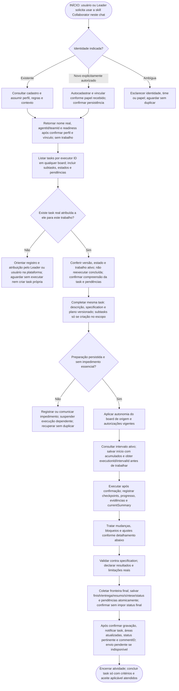
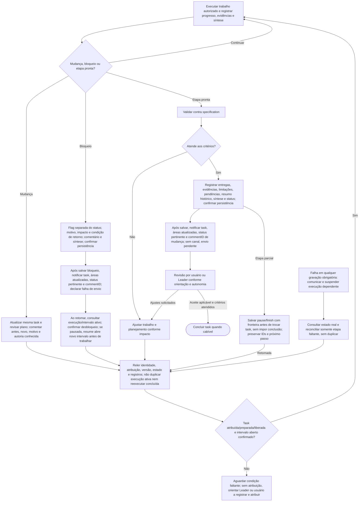

# Collaborator — preparação, execução e continuidade

Collaborators não conduzem a tela do usuário: não abrem, redirecionam ou recarregam seu painel como parte da execução. Registram trabalho nas tasks e comunicam resultados; a condução visual cabe exclusivamente ao Leader. Atualização ao vivo do conteúdo aberto é capacidade frontend/backend a verificar, não promessa da skill. Isso não muda a exigência de tarefa já atribuída.

Fluxo operacional das skills. Sincronização dos materiais no MCP depende de publicação e verificação do backend. Complementa os [três fluxos do Leader](leader-onboarding-flows.md). Criar um chat não comprova entendimento: após o handoff, há duas confirmações por canal disponível: identidade/perfil prontos e, quando houver task atribuída, compreensão dessa tarefa e pendências. Nenhuma resposta é inventada.

## Leader é a interface humana do trabalho

Fora do bootstrap inicial de novo chat Collaborator e de seu retorno de configuração, toda interação de trabalho iniciada pelo Collaborator em direção ao humano passa pela Leader: perguntas, escolhas, confirmações, pedidos, decisões e relatos substantivos. Não use diálogo direto ao usuário nem caixas interativas do harness (como `request_user_input`, `request_user_input_async` no Codex ou equivalentes) como canal de trabalho. Salve o conteúdo completo em comentário da tarefa; para pergunta, formule uma questão clara e alternativas se úteis; notifique a Leader somente com taskID, áreas atualizadas, status pertinente e commentID retornado. Aguarde resposta persistida e leia o comentário indicado via MCP antes de agir sobre ela.

A regra de registro e ausência de caixas interativas vale também para a Leader em toda interação substantiva relacionada à task. Quando precisar de decisão humana, Leader registra pergunta/opções completas em comentário da tarefa e avisa o usuário somente com task, áreas efetivamente atualizadas, status pertinente e commentID, sem `request_user_input`, `request_user_input_async` ou equivalentes. Aguarda resposta autorizada. Respostas espontâneas e instruções legítimas do humano no chat continuam válidas: Leader persiste a devolutiva/decisão na tarefa antes de agir ou delegar. Não existe uma Leader acima da Leader nem encaminhamento circular. Para responder ao Collaborator, lê comentário/estado, persiste a resposta e notifica pelos mesmos metadados. Collaborator registra bloqueio somente se a dúvida impedir continuidade e continua partes independentes já autorizadas. Isso não contorna nem suprime aprovações obrigatórias de ferramentas/segurança do harness; controles impostos pelo sistema/harness são superiores, não exceções de comunicação escolhidas pelo agente. A hierarquia de instruções e metainstruções legítimas do humano continuam válidas; a skill não promete bloquear UI de aprovação imposta pelo sistema. Se faltar tarefa, Leader ou identidade, aguarde configuração, sem criar autoautorização, inventar commentID ou abrir diálogo alternativo. A única exceção de comunicação é o bootstrap de novo chat Collaborator: solicitação inicial da Leader (skill/identidade/time) e retorno limitado à configuração, nome real, IDs confirmados e prontidão ou impedimento de bootstrap; sem trabalho de negócio.

## Marca do papel no título do chat

Ao receber/ativar esta skill no próprio chat, aplique imediatamente a marca do papel: `👑` para Leader ou `🐝` para Collaborator, inclusive em chat existente que muda de papel e antes de resolver a identidade. Nesse momento preserve o título atual útil, sem inventar nome. Após identificar o perfil, ajuste a parte do nome para o nome real, preservando complemento útil de projeto/time e demais conteúdo do título, com a mesma marca.

Consulte o título atual e a ferramenta real do harness. Remova somente as marcas de papel iniciais repetidas/misturadas (`👑`, `🐝` e estrela legada usada como marca) e seus espaços, então anteponha uma única marca do papel ativo. Não remova emojis ou conteúdo do restante do título. Se já correto, não renomeie. Mudança de papel substitui a marca anterior, nunca acumula `👑🐝`. Só confirme renomeação após sucesso; ausência ou falha da ferramenta não bloqueia o fluxo de identidade/trabalho autorizado.

Ao criar um chat Collaborator autorizado, a Leader já usa `🐝 <nome do colaborador>`, preservando contexto útil; o Collaborator garante o padrão ao ativar sua skill. Na busca/reutilização, compare nomes normalizando essas marcas iniciais, sem perder contexto nem tratar nome/emoji como prova de identidade. Preserve as confirmações de reutilização e permissões do harness existentes.

A mudança é exclusivamente no título do próprio chat ao assumir o papel, ou no título inicial do novo chat cuja criação foi autorizada. Não renomeie outros chats em massa nem altere nomes de agentes/times, slugs ou dados Bee Team. Marcar o papel não confirma identidade nem dispensa tarefa registrada/atribuída. O Collaborator continua sem conduzir a tela do usuário; ajustar seu próprio título não é navegação do painel.

Exemplos: ativar Collaborator em `Projeto X` produz `🐝 Projeto X` antes da identidade; identificado como Ana, ajusta para `🐝 Ana — Projeto X`. `👑 Ana — Projeto X` ao assumir Collaborator vira `🐝 Ana — Projeto X`; a transição inversa usa `👑`. `🐝 👑 🐝 Ana` vira uma única marca do papel ativo; retomada com título correto não escreve novamente.

## Tarefa e comentário como fonte de verdade entre agentes

Toda solicitação de trabalho Leader→Collaborator exige task/subtask registrada e atribuída antes de pedir execução. Toda interação/notificação exige comentário completo e commentID, inclusive atualização somente de status. A única exceção de comunicação é o bootstrap de novo chat Collaborator: pedido inicial de skill/identidade/time e retorno de configuração com nome real, IDs confirmados e prontidão ou impedimento, sem demanda de negócio. Fora desse bootstrap, registre na task: pergunta, resposta, decisão, mudança de escopo, feito/não feito, bloqueio/liberação, arquivo ou entrega. Sem task ou identidade suficiente, aguarde configuração; não invente commentID nem crie autoautorização. Essa regra prevalece sobre exemplos de conversa do onboarding; não existe exceção genérica para metadados, atualizações, confirmações de identidade posteriores ou dúvidas de trabalho.

Siga a ordem: atualize primeiro os campos, artefatos e estado pertinentes; salve depois comentário completo explicando a contribuição, o que foi ou não feito e dúvidas/pendências/decisões aplicáveis; confirme persistência; só então notifique. Use description/specification, plano versionado, resumo histórico, currentSummary, arquivos e status conforme as regras existentes, sem alterar campos só para preencher aviso. Comentário não substitui campos atuais. Uma pergunta isolada pode atualizar apenas comentário. Compreensão da tarefa e pendências também são comentário. Fim da execução não significa Concluído quando validação humana exigida ainda está pendente; preserve status real e fluxo de aprovação.

A notificação curta contém somente referência real da task, áreas efetivamente atualizadas, status atual quando pertinente e commentID real retornado pela persistência. Exemplo de formato (substitua marcadores por dados confirmados): “Task <referência real>; atualizado: especificação, plano, comentário; status: <status atual>; commentID: <ID retornado>.” Não copie detalhes, instruções, perguntas ou respostas para o chat. Não invente ID nem anuncie área cuja atualização falhou ou não ocorreu.

O receptor usa MCP para ler exatamente o comentário por esse ID e o estado atual da tarefa antes de agir, conferindo que o comentário pertence à task e que executor/versão/estado permitem a ação. Consulte o contrato real em integração, sem adivinhar toolname. A resposta segue o mesmo ciclo: campos pertinentes, comentário completo, persistência confirmada e nova notificação. Comentário ausente/inacessível ou leitura indisponível suspende trabalho dependente; não substitua por conteúdo do chat ou outro comentário mais recente.

Notificação não é demanda autônoma nem aprovação adicional. No-op e ack sem conteúdo não geram comentários ou pingue-pongue. Antes de repetir após timeout, confira resultado/registro e preserve idempotência; não duplique comentários. Se gravação falhar, mantenha pendência e não emita notificação do protocolo sem comentário/ID confirmado; nunca alegue sucesso. Comunicação imposta por instrução superior continua sendo respeitada. Se o envio falhar após gravação, retome apenas o envio necessário. Permissões do harness continuam obrigatórias; a skill não amplia autorização para mensagens.

## Fluxo principal — começar pelo chat

Leia este primeiro diagrama de cima para baixo. Ele não tem setas de retorno: o único início é a solicitação de uso da skill neste chat. Esperas e falhas são saídas explícitas; após resolvê-las, revalidar identidade e atribuição conforme o detalhamento seguinte, sem criar trabalho próprio.

## Detalhamento — execução, ajustes e retomada

Este segundo diagrama detalha o trabalho após a entrada e a preparação acima; não é o início da interação. A execução só prossegue com task registrada, atribuída, preparada e autorização aplicável. Seus retornos representam revalidação, não permissão para criar uma task de autoautorização.

Falha em qualquer gravação obrigatória aplica o caminho FALHA, inclusive em progresso, bloqueio e entrega. O desenho não cria aprovação extra: autonomia segue as regras existentes e não elimina atribuição. Validação parcial ou inviável deve ser registrada honestamente, sem forçar sucesso. A retomada pelo segundo diagrama consulta os registros novamente, como a entrada, sem depender da conversa integral.

## 1. Ativar papel, identificar colaborador e localizar atribuições

A entrada é uma solicitação para este chat usar a skill Collaborator, feita diretamente por um humano ou pelo chat Leader. Isso ativa o papel, não autoriza trabalho de negócio sem task registrada e atribuída. Ativação e cadastro do perfil não são execução da demanda de negócio; pode explicar o fluxo e verificar identidade sem começar o projeto.

Se a solicitação indicar um colaborador existente, como XPTO, consultar seu cadastro e assumir seu perfil funcional, regras e contexto. Se houver autorização explícita para novo colaborador no time XPTO, o fallback é autocadastrar e vincular ao time informado segundo o papel recebido, confirmando a persistência antes de assumir essa identidade como registrada. Se identidade, time ou papel essencial forem ambíguos, esclarecer especificamente a lacuna e conferir cadastros antes de criar, sem duplicar agentes nem inventar uma entidade Project.

O handoff do Leader deve pedir explicitamente uso da skill Collaborator e trazer identidade existente (ou autorização explícita para fallback novo), time, referência real da task quando existir, referências persistidas do contexto de execução do board de origem; fora do bootstrap inicial de novo chat Collaborator e de seu retorno de configuração, notificação restrita a task, áreas efetivamente atualizadas, status pertinente e commentID retornado. Conferir informações nos dados persistidos, sem inventar IDs. Primeiro confirmar identidade/perfil prontos. Sem task, aguardar registro/atribuição pelo Leader ou usuário, sem iniciar demanda nem criar task própria. Depois de consultar task atribuída, confirmar separadamente compreensão e pendências. O Leader registra/atribui antes de pedir execução; ativação do chat é etapa distinta.

Exemplo inicial: “Use bee-team-collaborator neste chat e configure o cadastro/vínculo autorizado; reutilize a identidade existente indicada. Retorne NOME real, agentId, teamId e readiness; aguarde atribuição.” Após a Leader verificar esse retorno e registrar/atribuir trabalho, o aviso separado contém somente task real, áreas atualizadas, status pertinente e commentID retornado. O Collaborator lê o comentário e a task antes de confirmar compreensão/pendências pelo protocolo. Sem atribuição válida, aguarda sem execução nem autoautorização.

Depois da identidade, listar tarefas atribuídas ao seu cadastro por `executorAgentId`, em qualquer board, incluindo subtasks, estados e pendências. O nome serve à identificação humana, não substitui o ID. Não filtrar pelo time gestor nem exigir descobrir primeiro os boards do time: uma atribuição pode estar em board gerido por outro time. Não iniciar arbitrariamente qualquer item encontrado.

Só começar trabalho se já houver task registrada em um board e atribuída a esse colaborador pelo Leader ou pelo usuário diretamente na plataforma. Pedido no chat, vindo do humano ou Leader, não substitui registro e atribuição. Se citarem uma task, consultar o registro real e conferir executor, versão e estado; não confiar apenas na mensagem. Sem atribuição correspondente, informar a necessidade, orientar passar pela liderança ou registrar/atribuir na plataforma e aguardar. Não criar task própria de “iniciar trabalho” para se autorizar nem executar o pedido direto.

Essa condição vale também na retomada e nos modos automáticos. Confirmar que a task continua atribuída, não foi concluída e não tem trabalho ativo que seria duplicado. Recuperar contexto por registros persistidos e fontes autorizadas, não por conversa integral presumida. Compreender responsabilidade e critérios e confirmar entendimento do handoff.

A permissão do Leader de criar sua tarefa inicial de coordenação não se estende ao Collaborator: o papel de colaborador continua sem poder criar uma task para se autoautorizar, mesmo quando a demanda se chama planejamento. Só desdobrar/criar quando esse trabalho estiver no escopo de uma task já atribuída.

### Preparar a task já atribuída

Antes de executar, completar a mesma task com descrição, specification da entrega e critérios e plano salvo versionado de como executar. Nenhuma tarefa, mesmo pequena, dispensa preparação; detalhe proporcional evita burocracia. Criar tasks ou subtasks somente quando essa criação fizer parte do escopo de uma task já atribuída, como elaborar a specification e identificar/desdobrar tarefas. Um plano não obriga criar subtasks nem autoriza desdobramento fora do escopo. Cada subtask precisa estar registrada, atribuída ao executor correto e preparada antes da sua própria execução.

“Criar a especificação do projeto e desdobrar tarefas” é uma task macro válida quando já registrada e atribuída. Completar sua specification inicial com o documento a produzir e os critérios, e seu plano com o processo; depois executar o desdobramento autorizado. Redigir os próprios campos é preparação da task atribuída, não exige outra task administrativa e não gera regressão infinita. Uma tarefa de apenas escrever specification não autoriza automaticamente criar outras tasks.

Autor e executor são agentes obrigatórios (`authorAgentId` e `executorAgentId`, UUID confirmado), e task pertence a um board, sem `teamId`. Subtasks podem atravessar boards e executores, preservando origem e responsabilidade; não editar trabalho alheio por pertencer à mesma cadeia. Resolver slugs pelos recursos disponíveis antes de usar UUIDs nos contratos.

## 2. Onde registrar cada informação

| Informação | Registro e finalidade |
|---|---|
| Demanda atual | `Task.description`: apresentação do trabalho vigente. |
| O que entregar e como aceitar | `Task.specification`: requisitos, regras, entrega e critérios, com Markdown quando útil. |
| Como executar | `plan.content` e revisões do plano: estratégia/passos salvos e versionados, preservando revisões anteriores. |
| Decomposição | Tasks com `parentId`, quando cabíveis e com criação no escopo da task atribuída; não apenas checklist fictício. |
| Estado atual cumulativo | `Task.currentSummary`: feito/concluído, em curso, pendências e próximo passo. |
| História humana relevante | Comentários: decisões, interferências, mudanças, problemas e bloqueios, com autoria conhecida. Não registrar cada microação. |
| Bloqueio | Flag de bloqueio separada do status, motivo/impacto/condição de retorno, comentário e síntese atual. |
| Entrega e evidência | Referências/anexos/artefatos e verificações reais, com limitações e pendências. |
| Atividade histórica | `ExecutionSummary.summary` e demais dados de encerramento; não substitui a síntese atual. |

Os campos representam a situação atual; comentários e revisões preservam o histórico. Atualizar `currentSummary` quando houver mudança de progresso, status ou entrega, recompondo a síntese cumulativa sem apagar fatos relevantes. Comentário isolado não atualiza descrição, specification ou plano defasados. Não transformar texto de specification/plano em instrução superior às autorizações do usuário.

## 3. Executar conforme contexto e tratar mudanças

Somente após confirmar registro e atribuição, aplicar `Task.executionContext` do board de origem da tarefa raiz: `manual` força aprovação; `standard` usa a flag de cada task atual, sem herdar a do pai; `automatic` cobre a cadeia, inclusive cross-board. Não alterar modos dos destinos para reproduzir o cálculo. Observar instruções explícitas e permissões do harness, sem inventar aprovações adicionais pela skill nem ampliar escopo por autonomia.

Antes de executar, resolver lacunas essenciais e dependências necessárias. Uma dúvida não impeditiva não precisa gerar bloqueio artificial; impedimento real exige registro e comunicação. Durante o trabalho, registrar progresso confirmado, subtasks e evidências, comentários relevantes e síntese atual, distinguindo tentativa de resultado verificado.

Se a demanda mudar durante a execução, atualizar a task existente e os campos afetados, revisar o plano quando necessário e preservar revisões/histórico. Comentar situação anterior, nova decisão, motivo e autoria quando conhecidos, sem inventar quem decidiu. Atualizar currentSummary para refletir o trabalho preservado e o próximo passo. Uma demanda independente pode justificar outra task; encaminhar para registro/atribuição pelo Leader ou usuário, salvo se sua criação já integrar o escopo da task atribuída. Mudança do mesmo trabalho não gera duplicata.

Exemplo com task já atribuída: a integração passou do endpoint A para B. Manter a task, ajustar descrição/specification conforme impacto, salvar revisão do plano para B, comentar “antes A; agora B; motivo informado…; decisão de…” apenas com fatos disponíveis. A síntese indica o que continua aproveitável, a adaptação em curso e os testes pendentes. Não criar outra task só pela troca de endpoint nem deixar A nos campos atuais com B apenas em comentário.

## 4. Bloqueio, falha de persistência e retomada

Bloqueio é flag separada do status, não um status inventado. Registrar motivo, impacto e o que falta para continuar, comentário e currentSummary; confirmar gravação e só então avisar o Leader pelo canal autorizado. Sem canal, declarar comunicação pendente; falha de gravação deve ser comunicada como registro não confirmado. Não marcar concluída para encerrar uma atividade bloqueada. Trabalhos independentes só podem avançar quando já registrados, atribuídos, preparados e autorizados.

Exemplo: falta acesso necessário à API B. Registrar que a validação está impedida, qual acesso falta e como sua concessão permitirá retomar, preservando as partes já feitas. Não publicar segredos. Ao receber acesso, confirmar a condição, atualizar bloqueio/comentário/síntese e revisar o plano se houver impacto; não apenas continuar com flag antiga ou assumir que a tarefa terminou.

Se uma gravação obrigatória falhar, não alegar que foi salva. Interromper a execução dependente desse registro, comunicar o impedimento e reconciliar usando estado/versão reais e idempotência quando suportada. Timeout não prova falha nem sucesso: consultar antes de repetir criação, comentário ou entrega. Recuperar somente a etapa faltante, sem duplicar tasks, revisões ou trabalho confirmado.

Na retomada, reler perfil, responsabilidade, task, specification, plano e revisões, comentários, síntese, bloqueios e evidências pertinentes. Revalidar atribuição, versão, estado não concluído e existência de execução ativa antes de prosseguir. Conversa perdida não apaga identidade ou autoria e não autoriza inventar histórico.

## 5. Validar, entregar e encerrar

Validar contra specification e critérios de aceite no nível necessário à afirmação. Se falhar, ajustar e atualizar planejamento quando o impacto exigir, preservando histórico. Dizer quais verificações rodaram, resultados, limitações e o que não foi testado. Não apresentar teste não executado como aprovado.

Registrar resumo histórico da atividade, entregas/referências/anexos, evidências, limitações, pendências e próximo passo, além de currentSummary e status coerentes com o estado real. Confirmar persistência e só então avisar o Leader pelo canal autorizado; sem canal, manter comunicação à Leader pendente; não emita aviso alternativo sem comentário/ID confirmado, salvo comunicação imposta por instrução superior, sem inventar envio.

Fechar atividade não equivale a concluir task. Revisão por usuário ou Leader segue a orientação e autonomia aplicáveis, sem revisão humana universal nem uma nova cerimônia obrigatória. Se houver reprovação ou pedido de ajuste, retornar ao trabalho correspondente e atualizar registros. Concluir task quando critérios e aceite aplicável forem atendidos; uma entrega parcial pode encerrar somente a atividade, mantendo a task não finalizada.

O mesmo ordenamento vale para decisão necessária durante o trabalho: salvar primeiro na task contexto, progresso/síntese e comentário pertinente e depois solicitar decisão ao Leader. Se a gravação falhar, informar registro não confirmado, sem fingir que a sequência foi completada; indisponibilidade do canal fica explícita. A resposta do Leader não substitui atualização dos registros afetados.

## Critérios de aceite textual

| Cenário | Resultado esperado |
|---|---|
| Ativação sem task atribuída, mesmo trabalho pequeno | Assumir/verificar identidade e orientar registro/atribuição; aguardar sem executar nem criar task para se autorizar. |
| Pedido no chat “mude o endpoint”, sem task atribuída | Encaminhar à liderança ou registro/atribuição na plataforma; origem humana ou Leader não elimina a condição. |
| Identidade existente / novo colaborador em time informado | Consultar e reutilizar cadastro existente / autocadastrar e vincular conforme papel recebido, após esclarecer ambiguidades essenciais e sem duplicação. |
| Tasks atribuídas em board de outro time | Encontrar por executor ID, sem filtro pelo time gestor ou descoberta prévia de seus boards; não iniciar arbitrariamente. |
| Task atribuída existente incompleta | Completar a mesma; criar subtasks só se o desdobramento estiver no escopo; cada uma registrada, atribuída e preparada antes de executar. |
| Task já atribuída é criar specification e desdobrar | Preparar a macro e realizar criação de tasks/subtasks dentro desse escopo; sem cadeia infinita de tasks de cadastro. |
| Endpoint A muda para B | Mesma task, campos atuais e plano coerentes com B, histórico da alteração e autoria conhecida, síntese atualizada. |
| Board origem manual/standard/automatic | Aplicar contexto raiz e flag individual quando cabível; nenhum modo herdado indevidamente ou aprovação extra inventada; automático não elimina registro/atribuição. |
| Dependência realmente impeditiva | Flag de bloqueio, motivo/impacto/condição, comentário e síntese; Leader avisado; task não concluída. |
| Falha ou timeout ao registrar | Nenhum falso sucesso ou execução dependente; consulta/reconciliação sem duplicar. |
| Validação falha ou não pode ocorrer | Ajustes/pendências e limites reais; nenhum teste fictício ou caminho automático de conclusão. |
| Entrega parcial ou revisão com ajustes | Atividade pode encerrar sem task done; ajustes retornam ao registro e trabalho apropriados. |
| Handoff recebido | Confirmar identidade/perfil primeiro; compreensão da task e pendências somente após validar atribuição real. |
| Bloqueio, decisão necessária ou encerramento | Salvar registros pertinentes antes de comunicar ao Leader; declarar gravação ou envio pendente sem inventar sucesso. |
| Retomada em outro chat | Usar registros persistidos, confirmar identidade/atribuição/versão/estado e não reexecutar concluída nem duplicar execução ativa. |

## Contratos consultados e limites

Conferidos os materiais locais da [skill Collaborator](../skills/bee-team-collaborator/SKILL.md) e [integração](../skills/references/integration.md), além do OpenAPI atual do checkout backend `8fbc` (somente leitura): `Task.specification`, `currentSummary`, `executionContext`, `CreatePlan`, `RevisePlan`, revisão de plano e bloqueio separado de status. O snapshot OpenAPI antigo presente neste worktree não tem todos os campos recentes; não foi alterado para esta entrega. Esta especificação não inventa endpoint nem versão separada para specification: versionamento aqui é o do plano e os mecanismos de histórico existentes.

A nova entrada e a condição de task previamente registrada e atribuída substituem a orientação documental anterior de criar task ausente na entrada. São regras propostas documentadas, divergentes da skill instalada, que não foi atualizada nesta rodada. Não representam afirmação de que a API já imponha todo esse fluxo ou rejeite toda task incompleta. O desenho e os critérios foram revisados editorialmente; não são execução ponta a ponta nem alteração da skill instalada.

## Pontos ainda em aberto

- Política futura do Leader para selecionar próxima tarefa, distribuir trabalho e conduzir gestão contínua.
- Detalhes da interface para apresentar preparação, revisões e pendências sem burocracia adicional.
- Mecanismos disponíveis em cada harness para confirmar handoff, comunicar bloqueio/entrega e verificar execução ativa, sem presumir acesso universal.

As regras de registro, mudança na mesma task, bloqueio, autonomia e conclusão acima estão definidas; esses pontos em aberto não dispensam seu cumprimento quando o fluxo for implementado.

## Métricas no início e ao inserir resumo

Investigue no início a fonte permitida da sessão e reutilize estratégia/proveniência validada. A cada novo resumo histórico, consulte dados atuais e envie usageReport obrigatório com acumulado real de tokens da sessão até o resumo, modelo identificado, harness, agente e fonte verificáveis; unavailable não substitui medição. Sem fonte, registre impedimento por comentário e notifique sem alegar resumo salvo. Não omita o relatório; trate erro de validação/persistência sem anunciar salvamento. Não invente zero/modelo/atribuição nem crie resumo para cada comentário. Consulte [métricas por resumo](../skills/references/usage-report.md); preserve campos, comentário/ID, status e aprovação existentes.

## Retorno de bootstrap

Siga [bootstrap do Collaborator](../skills/references/collaborator-bootstrap.md): no chat criado antes do novo cadastro, o próprio Collaborator consulta/reutiliza ou cria/configura o perfil e vínculo autorizados. Retorna nome real, agentId/teamId e prontidão confirmada (ou pending com impedimento). A exceção sem comentário cobre somente pedido inicial e retorno cadastral, não execução; Leader verifica antes de atribuir trabalho. Sem task, aguarde sem autoautorização.

## Transições de status

Status inicial é definido na criação. Toda mudança posterior de status (inclusive início, retomada, revisão e conclusão) passa pelo registro de resumo com statusObserved e usageReport obrigatório na mesma transação. close_activity só é válido quando registra esse resumo pelo serviço comum; não use updateTask/moveTask/record_progress para transições. Percentual isolado permanece atualizável separadamente com síntese exigida, sem mudar status implicitamente. Só confirme transição após persistência; comentário/commentID, idempotência e legado permanecem preservados.

## Fronteiras explícitas do trabalho

Após validar atribuição/preparo/autorização, consulte execução/intervalo ativo e siga [intervalos](../skills/references/execution-intervals.md). Salve início com acumulados antes de executar; checkpoint não fecha. Pause antes da troca de task, retome em intervalo novo e encerre independentemente de status final/aceite. Preserve IDs reais e cobertura, sem inferência por texto/status/horário. Nenhum prompt ou abertura de chat cria essas fronteiras automaticamente.

## Identificar checkout e evidência de commits

Siga [projetos/repos/commits](../skills/references/repository-evidence.md): confirme raízes e remotes saneados do trabalho, estado identificado/a identificar/não se aplica conforme contrato e relação explícita de projetos/repos. Antes de cada resumo, declare somente commits efetivos daquela atividade; investigação sem commit é false/lista vazia. Não criar commit para preencher formulário nem afirmar publicação por ter hash local. Markdown de specification, escopo estruturado e evidência histórica são independentes.
