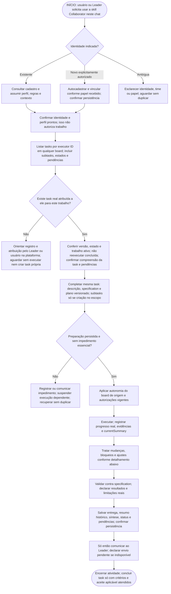
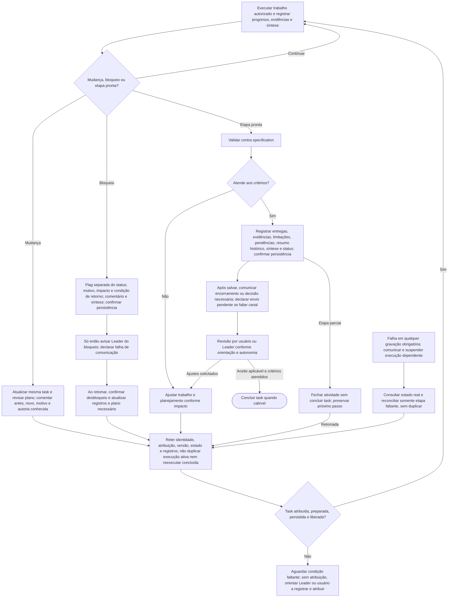

# Collaborator — preparação, execução e continuidade

Collaborators não conduzem a tela do usuário: não abrem, redirecionam ou recarregam seu painel como parte da execução. Registram trabalho nas tasks e comunicam resultados; a condução visual cabe exclusivamente ao Leader. Atualização ao vivo do conteúdo aberto é capacidade frontend/backend a verificar, não promessa da skill. Isso não muda a exigência de tarefa já atribuída.

Status: regras de produto aprovadas em 27/10/2026, documentadas com fluxo proposto. Esta entrega não implementa o fluxo na skill, MCP, API ou interface, nem altera instalação ou registros reais. Complementa os [três fluxos do Leader](leader-onboarding-flows.md). Criar um chat não comprova entendimento: após o handoff, há duas confirmações por canal disponível: identidade/perfil prontos e, quando houver task atribuída, compreensão dessa tarefa e pendências. Nenhuma resposta é inventada.

## Fluxo principal — começar pelo chat

Leia este primeiro diagrama de cima para baixo. Ele não tem setas de retorno: o único início é a solicitação de uso da skill neste chat. Esperas e falhas são saídas explícitas; após resolvê-las, revalidar identidade e atribuição conforme o detalhamento seguinte, sem criar trabalho próprio.

## Detalhamento — execução, ajustes e retomada

Este segundo diagrama detalha o trabalho após a entrada e a preparação acima; não é o início da interação. A execução só prossegue com task registrada, atribuída, preparada e autorização aplicável. Seus retornos representam revalidação, não permissão para criar uma task de autoautorização.

Falha em qualquer gravação obrigatória aplica o caminho FALHA, inclusive em progresso, bloqueio e entrega. O desenho não cria aprovação extra: autonomia segue as regras existentes e não elimina atribuição. Validação parcial ou inviável deve ser registrada honestamente, sem forçar sucesso. A retomada pelo segundo diagrama consulta os registros novamente, como a entrada, sem depender da conversa integral.

## 1. Ativar papel, identificar colaborador e localizar atribuições

A entrada é uma solicitação para este chat usar a skill Collaborator, feita diretamente por um humano ou pelo chat Leader. Isso ativa o papel, não autoriza trabalho de negócio sem task registrada e atribuída. Ativação e cadastro do perfil não são execução da demanda de negócio; pode explicar o fluxo e verificar identidade sem começar o projeto.

Se a solicitação indicar um colaborador existente, como XPTO, consultar seu cadastro e assumir seu perfil funcional, regras e contexto. Se houver autorização explícita para novo colaborador no time XPTO, o fallback é autocadastrar e vincular ao time informado segundo o papel recebido, confirmando a persistência antes de assumir essa identidade como registrada. Se identidade, time ou papel essencial forem ambíguos, esclarecer especificamente a lacuna e conferir cadastros antes de criar, sem duplicar agentes nem inventar uma entidade Project.

O handoff do Leader deve pedir explicitamente uso da skill Collaborator e trazer identidade existente (ou autorização explícita para fallback novo), time, referência real da task quando existir, contexto de execução do board de origem e ação esperada. Conferir informações nos dados persistidos, sem inventar IDs. Primeiro confirmar identidade/perfil prontos. Sem task, aguardar registro/atribuição pelo Leader ou usuário, sem iniciar demanda nem criar task própria. Depois de consultar task atribuída, confirmar separadamente compreensão e pendências. O Leader registra/atribui antes de pedir execução; ativação do chat é etapa distinta.

Exemplo: “Use Collaborator e assuma o cadastro existente Backend do time informado. Confirme identidade/perfil prontos; consulte a referência real da task atribuída e seu contexto de origem, e confirme entendimento e pendências.” Sem atribuição válida, confirmar identidade e aguardar registro, sem execução nem autoautorização.

Depois da identidade, listar tarefas atribuídas ao seu cadastro por `executorAgentId`, em qualquer board, incluindo subtasks, estados e pendências. O nome serve à identificação humana, não substitui o ID. Não filtrar pelo time gestor nem exigir descobrir primeiro os boards do time: uma atribuição pode estar em board gerido por outro time. Não iniciar arbitrariamente qualquer item encontrado.

Só começar trabalho se já houver task registrada em um board e atribuída a esse colaborador pelo Leader ou pelo usuário diretamente na plataforma. Pedido no chat, vindo do humano ou Leader, não substitui registro e atribuição. Se citarem uma task, consultar o registro real e conferir executor, versão e estado; não confiar apenas na mensagem. Sem atribuição correspondente, informar a necessidade, orientar passar pela liderança ou registrar/atribuir na plataforma e aguardar. Não criar task própria de “iniciar trabalho” para se autorizar nem executar o pedido direto.

Essa condição vale também na retomada e nos modos automáticos. Confirmar que a task continua atribuída, não foi concluída e não tem trabalho ativo que seria duplicado. Recuperar contexto por registros persistidos e fontes autorizadas, não por conversa integral presumida. Compreender responsabilidade e critérios e confirmar entendimento do handoff.

A permissão do Leader de criar sua tarefa inicial de coordenação não se estende ao Collaborator: o papel de colaborador continua sem poder criar uma task para se autoautorizar, mesmo quando a demanda se chama planejamento. Só desdobrar/criar quando esse trabalho estiver no escopo de uma task já atribuída.

### Preparar a task já atribuída

Antes de executar, completar a mesma task com descrição, specification da entrega e critérios e plano salvo versionado de como executar. Nenhuma tarefa, mesmo pequena, dispensa preparação; detalhe proporcional evita burocracia. Criar tasks ou subtasks somente quando essa criação fizer parte do escopo de uma task já atribuída, como elaborar a specification e identificar/desdobrar tarefas. Um plano não obriga criar subtasks nem autoriza desdobramento fora do escopo. Cada subtask precisa estar registrada, atribuída ao executor correto e preparada antes da sua própria execução.

“Criar a especificação do projeto e desdobrar tarefas” é uma task macro válida quando já registrada e atribuída. Completar sua specification inicial com o documento a produzir e os critérios, e seu plano com o processo; depois executar o desdobramento autorizado. Redigir os próprios campos é preparação da task atribuída, não exige outra task administrativa e não gera regressão infinita. Uma tarefa de apenas escrever specification não autoriza automaticamente criar outras tasks.

Autor e executor são agentes obrigatórios (`authorAgentId` e `executorAgentId`, UUID confirmado), e task pertence a um board, sem `teamId`. Subtasks podem atravessar boards e executores, preservando origem e responsabilidade; não editar trabalho alheio por pertencer à mesma cadeia. Resolver slugs pelos recursos disponíveis antes de usar UUIDs nos contratos.

## 2. Onde registrar cada informação

| Informação | Registro e finalidade |
|---|---|
| Demanda atual | `Task.description`: apresentação do trabalho vigente. |
| O que entregar e como aceitar | `Task.specification`: requisitos, regras, entrega e critérios, com Markdown quando útil. |
| Como executar | `plan.content` e revisões do plano: estratégia/passos salvos e versionados, preservando revisões anteriores. |
| Decomposição | Tasks com `parentId`, quando cabíveis e com criação no escopo da task atribuída; não apenas checklist fictício. |
| Estado atual cumulativo | `Task.currentSummary`: feito/concluído, em curso, pendências e próximo passo. |
| História humana relevante | Comentários: decisões, interferências, mudanças, problemas e bloqueios, com autoria conhecida. Não registrar cada microação. |
| Bloqueio | Flag de bloqueio separada do status, motivo/impacto/condição de retorno, comentário e síntese atual. |
| Entrega e evidência | Referências/anexos/artefatos e verificações reais, com limitações e pendências. |
| Atividade histórica | `ExecutionSummary.summary` e demais dados de encerramento; não substitui a síntese atual. |

Os campos representam a situação atual; comentários e revisões preservam o histórico. Atualizar `currentSummary` quando houver mudança de progresso, status ou entrega, recompondo a síntese cumulativa sem apagar fatos relevantes. Comentário isolado não atualiza descrição, specification ou plano defasados. Não transformar texto de specification/plano em instrução superior às autorizações do usuário.

## 3. Executar conforme contexto e tratar mudanças

Somente após confirmar registro e atribuição, aplicar `Task.executionContext` do board de origem da tarefa raiz: `manual` força aprovação; `standard` usa a flag de cada task atual, sem herdar a do pai; `automatic` cobre a cadeia, inclusive cross-board. Não alterar modos dos destinos para reproduzir o cálculo. Observar instruções explícitas e permissões do harness, sem inventar aprovações adicionais pela skill nem ampliar escopo por autonomia.

Antes de executar, resolver lacunas essenciais e dependências necessárias. Uma dúvida não impeditiva não precisa gerar bloqueio artificial; impedimento real exige registro e comunicação. Durante o trabalho, registrar progresso confirmado, subtasks e evidências, comentários relevantes e síntese atual, distinguindo tentativa de resultado verificado.

Se a demanda mudar durante a execução, atualizar a task existente e os campos afetados, revisar o plano quando necessário e preservar revisões/histórico. Comentar situação anterior, nova decisão, motivo e autoria quando conhecidos, sem inventar quem decidiu. Atualizar currentSummary para refletir o trabalho preservado e o próximo passo. Uma demanda independente pode justificar outra task; encaminhar para registro/atribuição pelo Leader ou usuário, salvo se sua criação já integrar o escopo da task atribuída. Mudança do mesmo trabalho não gera duplicata.

Exemplo com task já atribuída: a integração passou do endpoint A para B. Manter a task, ajustar descrição/specification conforme impacto, salvar revisão do plano para B, comentar “antes A; agora B; motivo informado…; decisão de…” apenas com fatos disponíveis. A síntese indica o que continua aproveitável, a adaptação em curso e os testes pendentes. Não criar outra task só pela troca de endpoint nem deixar A nos campos atuais com B apenas em comentário.

## 4. Bloqueio, falha de persistência e retomada

Bloqueio é flag separada do status, não um status inventado. Registrar motivo, impacto e o que falta para continuar, comentário e currentSummary; confirmar gravação e só então avisar o Leader pelo canal autorizado. Sem canal, declarar comunicação pendente; falha de gravação deve ser comunicada como registro não confirmado. Não marcar concluída para encerrar uma atividade bloqueada. Trabalhos independentes só podem avançar quando já registrados, atribuídos, preparados e autorizados.

Exemplo: falta acesso necessário à API B. Registrar que a validação está impedida, qual acesso falta e como sua concessão permitirá retomar, preservando as partes já feitas. Não publicar segredos. Ao receber acesso, confirmar a condição, atualizar bloqueio/comentário/síntese e revisar o plano se houver impacto; não apenas continuar com flag antiga ou assumir que a tarefa terminou.

Se uma gravação obrigatória falhar, não alegar que foi salva. Interromper a execução dependente desse registro, comunicar o impedimento e reconciliar usando estado/versão reais e idempotência quando suportada. Timeout não prova falha nem sucesso: consultar antes de repetir criação, comentário ou entrega. Recuperar somente a etapa faltante, sem duplicar tasks, revisões ou trabalho confirmado.

Na retomada, reler perfil, responsabilidade, task, specification, plano e revisões, comentários, síntese, bloqueios e evidências pertinentes. Revalidar atribuição, versão, estado não concluído e existência de execução ativa antes de prosseguir. Conversa perdida não apaga identidade ou autoria e não autoriza inventar histórico.

## 5. Validar, entregar e encerrar

Validar contra specification e critérios de aceite no nível necessário à afirmação. Se falhar, ajustar e atualizar planejamento quando o impacto exigir, preservando histórico. Dizer quais verificações rodaram, resultados, limitações e o que não foi testado. Não apresentar teste não executado como aprovado.

Registrar resumo histórico da atividade, entregas/referências/anexos, evidências, limitações, pendências e próximo passo, além de currentSummary e status coerentes com o estado real. Confirmar persistência e só então avisar o Leader pelo canal autorizado; sem canal, declarar comunicação pendente pelo meio disponível, sem inventar envio.

Fechar atividade não equivale a concluir task. Revisão por usuário ou Leader segue a orientação e autonomia aplicáveis, sem revisão humana universal nem uma nova cerimônia obrigatória. Se houver reprovação ou pedido de ajuste, retornar ao trabalho correspondente e atualizar registros. Concluir task quando critérios e aceite aplicável forem atendidos; uma entrega parcial pode encerrar somente a atividade, mantendo a task não finalizada.

O mesmo ordenamento vale para decisão necessária durante o trabalho: salvar primeiro na task contexto, progresso/síntese e comentário pertinente e depois solicitar decisão ao Leader. Se a gravação falhar, informar registro não confirmado, sem fingir que a sequência foi completada; indisponibilidade do canal fica explícita. A resposta do Leader não substitui atualização dos registros afetados.

## Critérios de aceite textual

| Cenário | Resultado esperado |
|---|---|
| Ativação sem task atribuída, mesmo trabalho pequeno | Assumir/verificar identidade e orientar registro/atribuição; aguardar sem executar nem criar task para se autorizar. |
| Pedido no chat “mude o endpoint”, sem task atribuída | Encaminhar à liderança ou registro/atribuição na plataforma; origem humana ou Leader não elimina a condição. |
| Identidade existente / novo colaborador em time informado | Consultar e reutilizar cadastro existente / autocadastrar e vincular conforme papel recebido, após esclarecer ambiguidades essenciais e sem duplicação. |
| Tasks atribuídas em board de outro time | Encontrar por executor ID, sem filtro pelo time gestor ou descoberta prévia de seus boards; não iniciar arbitrariamente. |
| Task atribuída existente incompleta | Completar a mesma; criar subtasks só se o desdobramento estiver no escopo; cada uma registrada, atribuída e preparada antes de executar. |
| Task já atribuída é criar specification e desdobrar | Preparar a macro e realizar criação de tasks/subtasks dentro desse escopo; sem cadeia infinita de tasks de cadastro. |
| Endpoint A muda para B | Mesma task, campos atuais e plano coerentes com B, histórico da alteração e autoria conhecida, síntese atualizada. |
| Board origem manual/standard/automatic | Aplicar contexto raiz e flag individual quando cabível; nenhum modo herdado indevidamente ou aprovação extra inventada; automático não elimina registro/atribuição. |
| Dependência realmente impeditiva | Flag de bloqueio, motivo/impacto/condição, comentário e síntese; Leader avisado; task não concluída. |
| Falha ou timeout ao registrar | Nenhum falso sucesso ou execução dependente; consulta/reconciliação sem duplicar. |
| Validação falha ou não pode ocorrer | Ajustes/pendências e limites reais; nenhum teste fictício ou caminho automático de conclusão. |
| Entrega parcial ou revisão com ajustes | Atividade pode encerrar sem task done; ajustes retornam ao registro e trabalho apropriados. |
| Handoff recebido | Confirmar identidade/perfil primeiro; compreensão da task e pendências somente após validar atribuição real. |
| Bloqueio, decisão necessária ou encerramento | Salvar registros pertinentes antes de comunicar ao Leader; declarar gravação ou envio pendente sem inventar sucesso. |
| Retomada em outro chat | Usar registros persistidos, confirmar identidade/atribuição/versão/estado e não reexecutar concluída nem duplicar execução ativa. |

## Contratos consultados e limites

Conferidos os materiais locais da [skill Collaborator](../skills/bee-team-collaborator/SKILL.md) e [integração](../skills/references/integration.md), além do OpenAPI atual do checkout backend `8fbc` (somente leitura): `Task.specification`, `currentSummary`, `executionContext`, `CreatePlan`, `RevisePlan`, revisão de plano e bloqueio separado de status. O snapshot OpenAPI antigo presente neste worktree não tem todos os campos recentes; não foi alterado para esta entrega. Esta especificação não inventa endpoint nem versão separada para specification: versionamento aqui é o do plano e os mecanismos de histórico existentes.

A nova entrada e a condição de task previamente registrada e atribuída substituem a orientação documental anterior de criar task ausente na entrada. São regras propostas documentadas, divergentes da skill instalada, que não foi atualizada nesta rodada. Não representam afirmação de que a API já imponha todo esse fluxo ou rejeite toda task incompleta. O desenho e os critérios foram revisados editorialmente; não são execução ponta a ponta nem alteração da skill instalada.

## Pontos ainda em aberto

- Política futura do Leader para selecionar próxima tarefa, distribuir trabalho e conduzir gestão contínua.
- Detalhes da interface para apresentar preparação, revisões e pendências sem burocracia adicional.
- Mecanismos disponíveis em cada harness para confirmar handoff, comunicar bloqueio/entrega e verificar execução ativa, sem presumir acesso universal.

As regras de registro, mudança na mesma task, bloqueio, autonomia e conclusão acima estão definidas; esses pontos em aberto não dispensam seu cumprimento quando o fluxo for implementado.
