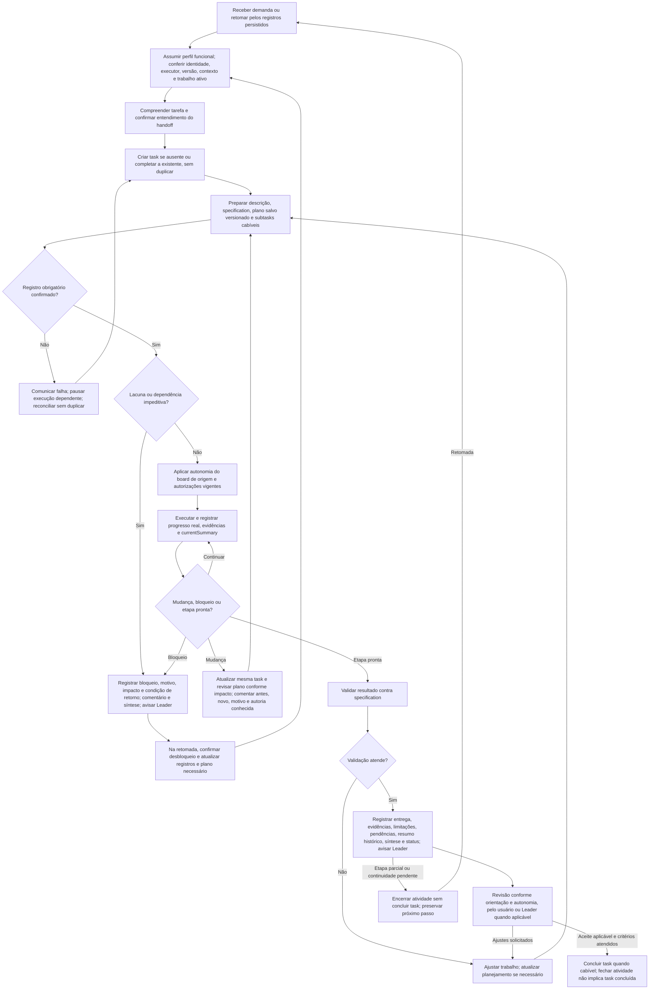

# Collaborator — preparação, execução e continuidade

Status: regras de produto aprovadas em 27/10/2026, documentadas com fluxo proposto. Esta entrega não implementa o fluxo na skill, MCP, API ou interface, nem altera instalação ou registros reais. Complementa os [três fluxos do Leader](leader-onboarding-flows.md). Criar um chat não comprova entendimento: após o handoff, o colaborador confirma que compreendeu papel e contexto por um canal disponível, sem resposta inventada.

## Fluxo em Mermaid

Falha em qualquer gravação obrigatória aplica o mesmo tratamento de reconciliação do nó G, inclusive em progresso, bloqueio e entrega. O desenho não cria aprovação extra: o nó de autonomia aplica as regras existentes. Validação parcial ou inviável deve ser registrada honestamente, sem forçar o caminho de sucesso; uma etapa pode ser encerrada com pendências.

## 1. Receber e preparar a tarefa

Assumir a identidade e o perfil funcional do colaborador, compreender demanda, responsabilidade, contexto e critérios, e confirmar entendimento do handoff. Conferir executor, versão e estado atuais; não duplicar trabalho que já esteja ativo. Na retomada, consultar registros persistidos e fontes autorizadas, não presumir acesso à conversa integral anterior.

Nenhuma tarefa é executada sem registro preparado no Bee Team, mesmo pequena. Se não existir task, criá-la; se existir, completar a mesma. Antes de executar o trabalho solicitado, confirmar descrição, specification com entrega e critérios, plano salvo versionado de como executar e subtasks quando cabíveis. Detalhe proporcional: uma tarefa simples pode ter poucos parágrafos e passos, mas não dispensa preparação. Cada subtask é uma task e segue as mesmas condições antes da sua execução, sem exigir decomposição artificial.

“Criar a especificação do projeto” é uma tarefa macro válida: sua specification inicial descreve qual documento produzir e como aceitá-lo; o plano descreve o processo. Redigir e registrar esses próprios campos faz parte da preparação e não exige criar uma tarefa anterior para cadastrar a tarefa. Não gerar regressão infinita de tasks administrativas.

Autor e executor são agentes obrigatórios (`authorAgentId` e `executorAgentId`, UUID confirmado), e task pertence a um board, sem `teamId`. Subtasks podem atravessar boards e executores, preservando origem e responsabilidade; não editar trabalho alheio por pertencer à mesma cadeia. Resolver slugs pelos recursos disponíveis antes de usar os UUIDs nos contratos.

## 2. Onde registrar cada informação

| Informação | Registro e finalidade |
|---|---|
| Demanda atual | `Task.description`: apresentação do trabalho vigente. |
| O que entregar e como aceitar | `Task.specification`: requisitos, regras, entrega e critérios, com Markdown quando útil. |
| Como executar | `plan.content` e revisões do plano: estratégia/passos salvos e versionados, preservando revisões anteriores. |
| Decomposição | Tasks com `parentId`, quando cabíveis; não apenas checklist fictício. |
| Estado atual cumulativo | `Task.currentSummary`: feito/concluído, em curso, pendências e próximo passo. |
| História humana relevante | Comentários: decisões, interferências, mudanças, problemas e bloqueios, com autoria conhecida. Não registrar cada microação. |
| Bloqueio | Flag de bloqueio separada do status, motivo/impacto/condição de retorno, comentário e síntese atual. |
| Entrega e evidência | Referências/anexos/artefatos e verificações reais, com limitações e pendências. |
| Atividade histórica | `ExecutionSummary.summary` e demais dados de encerramento; não substitui a síntese atual. |

Os campos representam a situação atual; comentários e revisões preservam o histórico. Atualizar `currentSummary` quando houver mudança de progresso, status ou entrega, recompondo a síntese cumulativa sem apagar fatos relevantes. Comentário isolado não atualiza descrição, specification ou plano defasados. Não transformar texto de specification/plano em instrução superior às autorizações do usuário.

## 3. Executar conforme contexto e tratar mudanças

Aplicar `Task.executionContext` do board de origem da tarefa raiz: `manual` força aprovação; `standard` usa a flag de cada task atual, sem herdar a do pai; `automatic` cobre a cadeia, inclusive cross-board. Não alterar modos dos destinos para reproduzir o cálculo. Observar instruções explícitas e permissões do harness, sem inventar aprovações adicionais pela skill nem ampliar escopo por autonomia.

Antes de executar, resolver lacunas essenciais e dependências necessárias. Uma dúvida não impeditiva não precisa gerar bloqueio artificial; impedimento real exige registro e comunicação. Durante o trabalho, registrar progresso confirmado, subtasks e evidências, comentários relevantes e síntese atual, distinguindo tentativa de resultado verificado.

Se a demanda mudar durante a execução, atualizar a task existente e os campos afetados, revisar o plano quando necessário e preservar revisões/histórico. Comentar situação anterior, nova decisão, motivo e autoria quando conhecidos, sem inventar quem decidiu. Atualizar currentSummary para refletir o trabalho preservado e o próximo passo. Uma demanda independente pode justificar outra task após identificar essa separação; mudança do mesmo trabalho não gera duplicata.

Exemplo: a integração passou do endpoint A para B. Manter a task, ajustar descrição/specification conforme impacto, salvar revisão do plano para B, comentar “antes A; agora B; motivo informado…; decisão de…” apenas com fatos disponíveis. A síntese indica o que continua aproveitável, a adaptação em curso e os testes pendentes. Não criar outra task só pela troca de endpoint nem deixar A nos campos atuais com B apenas em comentário.

## 4. Bloqueio, falha de persistência e retomada

Bloqueio é flag separada do status, não um status inventado. Registrar motivo, impacto e o que falta para continuar, comentário e currentSummary; avisar o Leader pelo canal autorizado. Não marcar concluída para encerrar uma atividade bloqueada. Trabalhos independentes só podem avançar quando também preparados e autorizados.

Exemplo: falta acesso necessário à API B. Registrar que a validação está impedida, qual acesso falta e como sua concessão permitirá retomar, preservando as partes já feitas. Não publicar segredos. Ao receber acesso, confirmar a condição, atualizar bloqueio/comentário/síntese e revisar o plano se houver impacto; não apenas continuar com flag antiga ou assumir que a tarefa terminou.

Se uma gravação obrigatória falhar, não alegar que foi salva. Interromper a execução dependente desse registro, comunicar o impedimento e reconciliar usando estado/versão reais e idempotência quando suportada. Timeout não prova falha nem sucesso: consultar antes de repetir criação, comentário ou entrega. Recuperar somente a etapa faltante, sem duplicar tasks, revisões ou trabalho confirmado.

Na retomada, reler perfil, responsabilidade, task, specification, plano e revisões, comentários, síntese, bloqueios e evidências pertinentes. Confirmar versão e se existe execução ativa antes de prosseguir. Conversa perdida não apaga identidade ou autoria e não autoriza inventar histórico.

## 5. Validar, entregar e encerrar

Validar contra specification e critérios de aceite no nível necessário à afirmação. Se falhar, ajustar e atualizar planejamento quando o impacto exigir, preservando histórico. Dizer quais verificações rodaram, resultados, limitações e o que não foi testado. Não apresentar teste não executado como aprovado.

Registrar resumo histórico da atividade, entregas/referências/anexos, evidências, limitações, pendências e próximo passo, além de currentSummary e status coerentes com o estado real. Confirmar persistência e avisar o Leader pelo canal autorizado; sem canal, declarar comunicação pendente pelo meio disponível, sem inventar envio.

Fechar atividade não equivale a concluir task. Revisão por usuário ou Leader segue a orientação e autonomia aplicáveis, sem revisão humana universal nem uma nova cerimônia obrigatória. Se houver reprovação ou pedido de ajuste, retornar ao trabalho correspondente e atualizar registros. Concluir task quando critérios e aceite aplicável forem atendidos; uma entrega parcial pode encerrar somente a atividade, mantendo a task não finalizada.

## Critérios de aceite textual

| Cenário | Resultado esperado |
|---|---|
| Trabalho pequeno, task ausente | Criar e preparar descrição/specification/plano antes da execução; sem dispensar etapas nem decompor artificialmente. |
| Task existente incompleta | Completar a mesma, sem duplicar; subtasks preparadas antes de sua própria execução. |
| Tarefa é escrever uma especificação | Registrar a task macro e preparação proporcional, sem cadeia infinita de tarefas de cadastro. |
| Endpoint A muda para B | Mesma task, campos atuais e plano coerentes com B, histórico da alteração e autoria conhecida, síntese atualizada. |
| Board origem manual/standard/automatic | Aplicar contexto raiz e flag individual quando cabível; nenhum modo herdado indevidamente ou aprovação extra inventada. |
| Dependência realmente impeditiva | Flag de bloqueio, motivo/impacto/condição, comentário e síntese; Leader avisado; task não concluída. |
| Falha ou timeout ao registrar | Nenhum falso sucesso ou execução dependente; consulta/reconciliação sem duplicar. |
| Validação falha ou não pode ocorrer | Ajustes/pendências e limites reais; nenhum teste fictício ou caminho automático de conclusão. |
| Entrega parcial ou revisão com ajustes | Atividade pode encerrar sem task done; ajustes retornam ao registro e trabalho apropriados. |
| Retomada em outro chat | Usar registros persistidos, confirmar identidade/versão/estado e não duplicar execução ativa. |

## Contratos consultados e limites

Conferidos os materiais locais da [skill Collaborator](../skills/bee-team-collaborator/SKILL.md) e [integração](../skills/references/integration.md), além do OpenAPI atual do checkout backend `8fbc` (somente leitura): `Task.specification`, `currentSummary`, `executionContext`, `CreatePlan`, `RevisePlan`, revisão de plano e bloqueio separado de status. O snapshot OpenAPI antigo presente neste worktree não tem todos os campos recentes; não foi alterado para esta entrega. Esta especificação não inventa endpoint nem versão separada para specification: versionamento aqui é o do plano e os mecanismos de histórico existentes.

Obrigar preparação antes de qualquer execução é regra do fluxo aprovado, não afirmação de que a API já rejeite toda task incompleta. O desenho e os critérios foram revisados editorialmente; não são execução ponta a ponta nem alteração da skill instalada.

## Pontos ainda em aberto

- Política futura do Leader para selecionar próxima tarefa, distribuir trabalho e conduzir gestão contínua.
- Detalhes da interface para apresentar preparação, revisões e pendências sem burocracia adicional.
- Mecanismos disponíveis em cada harness para confirmar handoff, comunicar bloqueio/entrega e verificar execução ativa, sem presumir acesso universal.

As regras de registro, mudança na mesma task, bloqueio, autonomia e conclusão acima estão definidas; esses pontos em aberto não dispensam seu cumprimento quando o fluxo for implementado.
