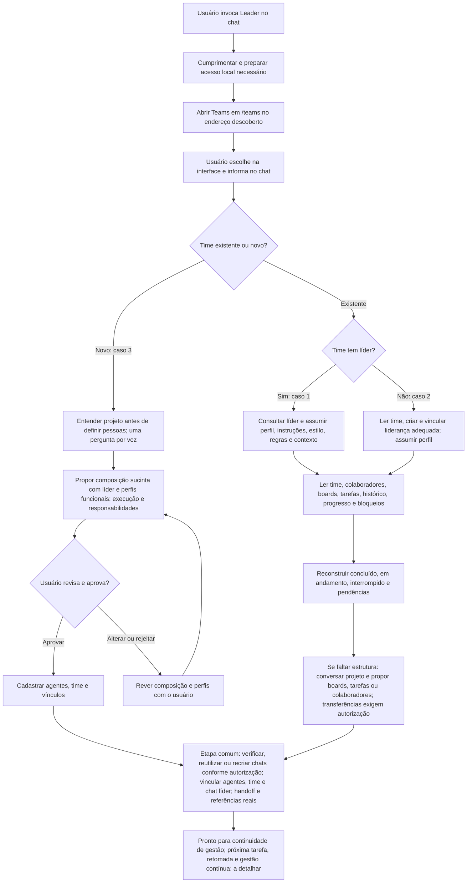

# Leader: entrada e formação de times

## Fluxograma dos três casos

Fluxo aprovado/proposto, ainda não implementado. O MCP ativo serve a Leader `dfd4e19`; os novos três casos permanecem documentação. MCP fornece registros, skills e prompts; o harness controla abertura do painel e criação de chats conforme capacidades e autorização.

A escolha na interface não é recebida automaticamente pelo chat. Squad com competências completas não habilita execução automática: preservar modos de boards/tasks. Projeto é a demanda, não uma entidade Project/workspace. Geração de avatar e demais mecanismos dependem das capacidades reais do harness e serão detalhados.

Status: decisões de produto aprovadas em 27/10/2026, documentadas para implementação posterior. Esta rodada não altera a skill executável, instalação pessoal, MCP, API, interface ou registros reais. Referência de comportamento atual: [Leader](../skills/bee-team-leader/SKILL.md) no commit `dfd4e19161b27a71451a05da4ab05d02e1379b0b`.

## Entrada comum aos três casos

O usuário inicia um chat mencionando a skill Leader. O agente cumprimenta brevemente, verifica ou prepara o acesso local quando necessário, reutilizando serviços saudáveis, e abre o aplicativo na tela **Teams**, rota `/teams`. Descobre o endereço da instalação; no ambiente atual, o endereço esperado é `http://127.0.0.1:5173/teams`, não um endereço universal. A abertura depende do navegador disponível no harness; se não puder abrir, informa a limitação e entrega o link correto, sem alegar que abriu a tela.

Pede ao usuário escolher um time existente ou criar um time. O usuário faz a escolha na interface e informa no chat qual foi sua escolha. Não existe, nesta especificação, garantia de que um evento da interface chegue automaticamente ao agente. Não interpretar apenas abertura, clique ou estado anterior da tela como comunicação da escolha. Se o usuário já informou explicitamente a escolha no contexto do chat, utilizá-la sem repetir a pergunta.

Conferências técnicas de conexão MCP, API, banco e painel dão suporte à conversa, sem substituir a escolha por um checklist técnico. Servidor acessível, conexão configurada e ferramentas expostas no chat são verificações distintas. Em indisponibilidade, informar o impedimento, preservar dados e continuar somente conversa ou atividades independentes possíveis; não inventar consultas ou persistência.

## Caso 1 — Time existente com líder

Após receber a escolha no chat, consultar o time e identificar seu agente líder. Carregar o perfil único desse agente, seus dados, instruções, estilo, regras, limites e contexto, assumindo essa identidade funcional nesta sessão. Não criar outro líder nem sobrescrever perfil ou associação para adequá-los ao chat.

Ler descrição e contexto do time, colaboradores, boards sob sua gestão e tarefas relacionadas. Consultar histórico, progresso, pendências e bloqueios para reconstruir o que foi concluído, o que está em andamento e o que foi interrompido. Diferenciar registros históricos de atividade confirmada agora; apresentar lacunas sem inventar continuidade.

O resultado é um líder contextualizado, pronto para continuar a gestão com o usuário. A política para escolher a próxima tarefa, retomar atividades interrompidas, distribuir trabalho ou manter gestão contínua será detalhada depois. Este documento não escolhe automaticamente uma tarefa nem autoriza execução só por carregar o contexto.

## Caso 2 — Time escolhido sem líder

Consultar primeiro as informações do time escolhido. Criar liderança por meio de um agente adequado a esse time e assumir seu perfil nesta sessão. Essa criação é parte do fluxo aprovado pelo usuário: substitui a regra anterior de apenas parar e perguntar genericamente o que fazer quando o time não tem líder. Não exigir uma nova pergunta genérica exclusivamente pela ausência do líder.

A criação deve usar informações reais do time e respeitar os contratos e vínculos válidos. Se faltar um dado obrigatório ou houver uma inconsistência diferente da simples ausência de líder, esclarecer especificamente essa lacuna; não inventar requisitos, identidade persistida ou sucesso de cadastro. Detalhes de como derivar e revisar o perfil desse líder serão refinados posteriormente.

Depois de estabelecer a liderança, conhecer membros, boards, tarefas e situação atual com a mesma leitura contextual do caso 1. Se faltar estrutura para o trabalho, conversar sobre o projeto e propor o próximo passo adequado: criar board, assumir ou transferir a gestão de um board existente quando autorizado, organizar tarefas ou colaboradores.

A criação da liderança não concede autorização irrestrita para transferir gestão, mover dados, modificar perfis existentes ou executar tarefas. Propostas de estrutura e suas autorizações devem ser concretas; sequência e política de gestão posterior permanecem em aberto.

## Caso 3 — Criar novo time

Antes de cadastrar qualquer coisa, conversar e incentivar o usuário a detalhar o projeto: objetivo, história e contexto, área de atuação, entregas esperadas e organização do trabalho. Fazer perguntas curtas, uma por vez, aproveitando as respostas já fornecidas. Projeto significa a demanda discutida; não introduz entidade `Project` ou workspace no modelo.

A LLM decide naturalmente se usa ferramentas ou skills auxiliares disponíveis que julgue úteis, como brainstorming, assim como em qualquer projeto. Esse apoio é opcional, não uma etapa do fluxo nem uma escolha que o Leader deva impor ao usuário. Não pedir ao usuário que selecione uma skill nem bloquear a descoberta aguardando isso. O usuário pode sugerir uma espontaneamente; a conversa continua centrada no projeto e nos objetivos. O fluxo é portável e não pressupõe Codex, plugins ou ferramentas ausentes.

Somente com compreensão clara da demanda, propor um squad multidisciplinar suficiente para as necessidades do projeto. A composição não se limita a desenvolvimento: pode incluir backend e frontend, ou finanças, pricing e marketing, entre outras especialidades pertinentes. Dimensionar a equipe pelo trabalho, sem impor uma lista fixa de perfis.

Definir perfis funcionais, inclusive o líder, centrados em execução e responsabilidade: escopo, descrição da atuação, especialidade, responsabilidades, instruções, estilo de trabalho e regras úteis ao projeto. Não criar personagens ou biografias fictícias com idade, juventude, história pessoal ou personalidade ornamental. Nome e avatar permanecem elementos de identificação, sem longa discussão nem aprovação individual obrigatória. Indicar identidades a reutilizar ou criar, respeitando vínculos e perfil único. Geração e armazenamento do avatar dependem de mecanismos a detalhar e das capacidades reais do harness.

Apresentar a composição de forma sucinta, fluida e direta por padrão. Aprofundar um perfil individual somente se o usuário pedir ou um requisito essencial realmente exigir; não prolongar a entrevista para preencher detalhes ornamentais. Uma aprovação objetiva da composição é suficiente, sem exigir aprovações separadas por agente ou campo. O usuário pode alterar, rejeitar ou aprovar; incorporar mudanças e obter aprovação da proposta resultante antes de cadastrar agentes, time e vínculos. A intenção de criar um time ou o silêncio não aprovam uma composição indefinida. Essa aprovação é requisito explícito, independente de modos automáticos de tarefas ou boards.

Exemplo compacto: “Eu lidero a coordenação. Backend: backend e infraestrutura; Frontend: interface; QA: testes. Criaremos chats separados para esse trabalho. Posso prosseguir?”. Nomes e avatares identificam os agentes, sem transformar essa proposta em uma discussão de biografias.

Depois da aprovação aplicável, cadastrar agentes, time e vínculos e seguir a etapa comum de gestão de chats abaixo. Para um time novo, criar chats separados dos colaboradores e vinculá-los ao chat atual do líder para comunicação; a aprovação concreta da proposta pode incluir essa criação. Não solicitar novamente permissão para ações já cobertas pela autorização vigente.

Squad autônomo significa cobertura de competências para realizar o projeto. Não ativa execução automática: continuam valendo os modos e o contexto de origem de boards/tasks, além das permissões para ações externas. Formação do time, criação de chats e início do trabalho são fatos distintos a confirmar.

## Etapa comum aos três casos — Gestão e vínculo de chats

Após contextualizar um time existente, com ou sem líder anterior, ou formar um time novo, verificar as sessões de trabalho antes da continuidade de gestão. Vincular o chat atual à identidade do líder e registrar as referências de coordenação entre agentes, time, chats dos colaboradores e chat coordenador. Se o harness não tiver relação nativa pai/filho, representar isso como referência de coordenação pelos mecanismos suportados; não inventar hierarquia ou capacidade de comunicação.

Consultar referências persistidas e verificar existência e acesso reais às sessões no harness. Reutilizar chats válidos. Um chat pode ter sido apagado, estar perdido ou não existir; referência antiga não comprova disponibilidade. Nome do agente pode orientar um nome legível para o chat, mas nomes iguais ou semelhantes não comprovam identidade: priorizar ID/referência persistente do harness e conferir o agente associado. Se o acesso não puder ser confirmado, declarar essa limitação, sem afirmar que o chat foi apagado.

Quando for necessário criar ou recriar uma sessão, propor ou executar a substituição conforme o modo e as autorizações vigentes, incluindo as exigências do harness. Para times existentes, não presumir autorização apenas porque há um cadastro de agente; também não repetir perguntas quando a ação já estiver autorizada. Para time novo, a aprovação da composição pode cobrir os chats explicitados na proposta. Esta documentação não solicita criação de chats reais agora.

Recriar chat não duplica o agente nem apaga autoria ou histórico. Manter a identidade persistente e preparar handoff com perfil funcional, contexto, tarefas relevantes, plano, specification, currentSummary, pendências e limites. Recuperar apenas informações disponíveis; não alegar recuperação integral de uma conversa inexistente. Persistir a referência real da nova sessão e seu vínculo com agente, time e chat líder, preservando o histórico da substituição pelos recursos suportados.

Se faltarem ferramentas para consultar, criar ou vincular chats, informar a etapa pendente e fornecer handoff para abertura pelo mecanismo disponível. Não tratar subagente temporário como chat persistente nem afirmar comunicação entre sessões sem capacidade confirmada. A política de próxima tarefa e gestão contínua continua em aberto.

## Modelo e limites preservados

- Boards têm um time gestor; a autoria do board é preservada. Transferir gestão exige autorização e operação compatível com o contrato.
- Tasks têm board, autor e executor; não introduzir `teamId` ou propriedade de task por time. A leitura de tarefas relacionadas deve considerar essas relações, sem assumir que todos os executores pertencem ao time gestor do board.
- Subtasks são recursivas e podem atravessar boards e executores. Preservar contexto de origem e regras de autonomia; não atribuir gestão de outro board implicitamente pela relação pai/filho.
- Agente tem perfil único e pode liderar no máximo um time e colaborar em no máximo um time, em times diferentes. Não duplicar identidade para contornar vínculos.
- Ausência de líder no caso 2 tem encaminhamento aprovado próprio. Identidade ambígua, conflito de vínculo ou falha de persistência continuam exigindo tratamento explícito, sem substituição silenciosa.
- Não configurar credenciais, mudar políticas, contornar recusa de ferramenta ou reiniciar serviços saudáveis como consequência automática da abertura da conversa.

## Transições e critérios de aceite textual

| Estado/entrada | Transição esperada | Critério de aceite |
|---|---|---|
| Chat inicia com Leader | Cumprimentar, preparar acesso necessário e abrir Teams | Endereço descoberto; tela `/teams` aberta ou limitação declarada com link; pergunta de escolha compreensível. |
| Usuário escolhe apenas na interface | Aguardar informação no chat | Nenhuma escolha inferida como evento recebido automaticamente. |
| Escolha já informada explicitamente | Resolver o time ou intenção de criação | Sem pergunta repetida; ambiguidades reais esclarecidas. |
| Time com líder | Carregar líder e contexto do time | Mesma identidade/perfil preservados; visão de concluído/em andamento/interrompido e lacunas; nenhuma próxima tarefa arbitrariamente iniciada. |
| Time sem líder | Ler time, criar liderança adequada e assumir perfil | Ausência não gera parada genérica; criação confirmada antes de assumir identidade persistida; vínculos respeitados. |
| Time sem estrutura suficiente | Conversar projeto e propor organização | Criar/transferir board ou organizar pessoas/tarefas não ocorre como autorização implícita irrestrita. |
| Novo time solicitado | Descobrir demanda uma pergunta por vez | Nenhum cadastro antes de compreender projeto e aprovar proposta concreta. |
| Compreensão suficiente | Propor composição sucinta e perfis funcionais | Inclui líder, execução e responsabilidades; nome/avatar identificam, sem biografias fictícias ou aprovação individual obrigatória. Uma aprovação objetiva basta; aprofundamento apenas a pedido ou por requisito essencial. |
| Proposta alterada/rejeitada | Revisar e obter aprovação resultante | Nenhum cadastro da proposta rejeitada; silêncio não aprova. |
| Proposta aprovada | Cadastrar agentes/time/vínculos e seguir etapa comum de chats | Aprovação pode incluir chats dos colaboradores; nenhum pedido de permissão repetido para ação já coberta. |
| Qualquer caso contextualizado/formado | Verificar, reutilizar ou recriar e vincular chats | Chat atual associado ao líder; referências reais ligam colaboradores, agentes, time e coordenação, sem presumir pai/filho nativo. |
| Referência de chat ausente ou chat confirmado apagado | Criar substituto conforme autorização vigente | Mesmo agente, autoria e histórico preservados; novo ID persistido e handoff com perfil, tarefas, plano, specification, currentSummary e pendências. |
| Chat com nome igual ou semelhante | Conferir ID, associação e acesso antes de reutilizar | Nome sozinho não identifica sessão; não reutilizar o chat de outro agente por semelhança. |
| Referência existe, acesso não confirmado | Declarar limitação e tratar próxima ação autorizada | Não afirmar exclusão ou recuperar conversa integral inexistente; falhas parciais não são apresentadas como sucesso. |
| Squad formado | Preparar continuidade de gestão | Competências completas não mudam autonomia de execução; política posterior ainda não definida. |

## Decisões aprovadas versus implementação atual

| Tema | Leader `dfd4e19` | Decisão deste documento |
|---|---|---|
| Entrada | Pergunta qual time usar salvo contexto explícito; readiness e onboarding MCP documentados | Acrescentar saudação, abertura de Teams e escolha feita na interface e comunicada no chat. |
| Time com líder | Reutiliza líder/perfil/contexto sem duplicação | Detalhar leitura de descrição, colaboradores, boards, tarefas e situação histórica/atual antes da gestão. |
| Time sem líder | Pede decisão ao usuário antes de assumir ou cadastrar | Substituir pela criação de liderança adequada como parte do caso 2, com tratamento específico de outras lacunas. |
| Time novo | Descoberta, proposta de composição e aprovação antes de cadastro | Propor perfis funcionais sucintos, preservando nome/avatar, abrangência multidisciplinar e chats separados após aprovação objetiva. |
| Chats nos três casos | Referências e retomada gerais, sem esta etapa comum explícita | Verificar existência/acesso, reutilizar ou substituir conforme autorização e vincular à identidade do agente, time e chat líder. |
| Gestão posterior | Regras gerais de coordenação e autonomia | Não acrescentar política automática de próxima tarefa ou continuidade nesta rodada. |

O documento registra intenção aprovada, não comprova que a skill, o frontend ou o MCP já executem os novos comportamentos. A divergência do caso 2 é deliberadamente explicitada; sua implementação será uma etapa posterior autorizada.

## Decisões ainda pendentes

1. Política de escolher próxima tarefa, retomar interrupções e conduzir gestão contínua após contextualização.
2. Detalhes para derivar o perfil da liderança ausente e tratar dados obrigatórios incompletos, concorrência ou falha parcial na criação/vínculo.
3. Sequência e autorização de criar boards, assumir/transferir sua gestão e organizar tarefas/colaboradores quando faltar estrutura.
4. Geração, escolha, armazenamento e limites dos avatares em diferentes harnesses.
5. Detalhes operacionais de persistência dos vínculos de coordenação e recuperação de falhas parciais entre cadastro e criação/substituição de chats, sem inventar atomicidade ou relação pai/filho nativa no harness. A exigência da etapa comum de chats já está definida acima.
6. Eventual integração de eventos de seleção da interface com o chat. Por enquanto, a comunicação é explícita pelo usuário.

## Escopo desta entrega

Somente esta especificação e uma referência no README. Sem alterações em `SKILL.md`, instalação pessoal, configuração MCP, snapshots do servidor, API/UI, agentes, times, boards, tarefas ou chats reais. Critérios acima são textuais; não representam teste ponta a ponta dos fluxos futuros.
