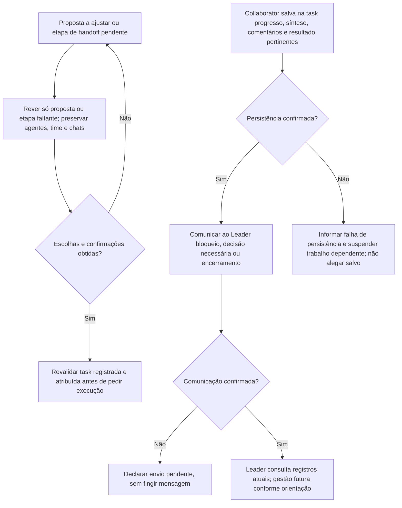

# Leader: entrada e formação de times

Continuidade após o handoff: [fluxo de trabalho do Collaborator](collaborator-workflow.md), documentado separadamente com Mermaid.

## Leader é a interface humana do trabalho

Fora do bootstrap inicial de novo chat Collaborator e de seu retorno de configuração, toda interação de trabalho iniciada pelo Collaborator em direção ao humano passa pela Leader: perguntas, escolhas, confirmações, pedidos, decisões e relatos substantivos. Não use diálogo direto ao usuário nem caixas interativas do harness (como `request_user_input`, `request_user_input_async` no Codex ou equivalentes) como canal de trabalho. Salve o conteúdo completo em comentário da tarefa; para pergunta, formule uma questão clara e alternativas se úteis; notifique a Leader somente com taskID, áreas atualizadas, status pertinente e commentID retornado. Aguarde resposta persistida e leia o comentário indicado via MCP antes de agir sobre ela.

A regra de registro e ausência de caixas interativas vale também para a Leader em toda interação substantiva relacionada à task. Quando precisar de decisão humana, Leader registra pergunta/opções completas em comentário da tarefa e avisa o usuário somente com task, áreas efetivamente atualizadas, status pertinente e commentID, sem `request_user_input`, `request_user_input_async` ou equivalentes. Aguarda resposta autorizada. Respostas espontâneas e instruções legítimas do humano no chat continuam válidas: Leader persiste a devolutiva/decisão na tarefa antes de agir ou delegar. Não existe uma Leader acima da Leader nem encaminhamento circular. Para responder ao Collaborator, lê comentário/estado, persiste a resposta e notifica pelos mesmos metadados. Collaborator registra bloqueio somente se a dúvida impedir continuidade e continua partes independentes já autorizadas. Isso não contorna nem suprime aprovações obrigatórias de ferramentas/segurança do harness; controles impostos pelo sistema/harness são superiores, não exceções de comunicação escolhidas pelo agente. A hierarquia de instruções e metainstruções legítimas do humano continuam válidas; a skill não promete bloquear UI de aprovação imposta pelo sistema. Se faltar tarefa, Leader ou identidade, aguarde configuração, sem criar autoautorização, inventar commentID ou abrir diálogo alternativo. A única exceção de comunicação é o bootstrap de novo chat Collaborator: solicitação inicial da Leader (skill/identidade/time) e retorno limitado à configuração, nome real, IDs confirmados e prontidão ou impedimento de bootstrap; sem trabalho de negócio.

## Marca do papel no título do chat

Ao receber/ativar esta skill no próprio chat, aplique imediatamente a marca do papel: `👑` para Leader ou `🐝` para Collaborator, inclusive em chat existente que muda de papel e antes de resolver a identidade. Nesse momento preserve o título atual útil, sem inventar nome. Após identificar o perfil, ajuste a parte do nome para o nome real, preservando complemento útil de projeto/time e demais conteúdo do título, com a mesma marca.

Consulte o título atual e a ferramenta real do harness. Remova somente as marcas de papel iniciais repetidas/misturadas (`👑`, `🐝` e estrela legada usada como marca) e seus espaços, então anteponha uma única marca do papel ativo. Não remova emojis ou conteúdo do restante do título. Se já correto, não renomeie. Mudança de papel substitui a marca anterior, nunca acumula `👑🐝`. Só confirme renomeação após sucesso; ausência ou falha da ferramenta não bloqueia o fluxo de identidade/trabalho autorizado.

Ao criar um chat Collaborator autorizado, a Leader já usa `🐝 <nome do colaborador>`, preservando contexto útil; o Collaborator garante o padrão ao ativar sua skill. Na busca/reutilização, compare nomes normalizando essas marcas iniciais, sem perder contexto nem tratar nome/emoji como prova de identidade. Preserve as confirmações de reutilização e permissões do harness existentes.

A mudança é exclusivamente no título do próprio chat ao assumir o papel, ou no título inicial do novo chat cuja criação foi autorizada. Não renomeie outros chats em massa nem altere nomes de agentes/times, slugs ou dados Bee Team. Marcar o papel não confirma identidade nem dispensa tarefa registrada/atribuída. O Collaborator continua sem conduzir a tela do usuário; ajustar seu próprio título não é navegação do painel.

Exemplos: ativar Collaborator em `Projeto X` produz `🐝 Projeto X` antes da identidade; identificado como Ana, ajusta para `🐝 Ana — Projeto X`. `👑 Ana — Projeto X` ao assumir Collaborator vira `🐝 Ana — Projeto X`; a transição inversa usa `👑`. `🐝 👑 🐝 Ana` vira uma única marca do papel ativo; retomada com título correto não escreve novamente.

## Tarefa e comentário como fonte de verdade entre agentes

Toda solicitação de trabalho Leader→Collaborator exige task/subtask registrada e atribuída antes de pedir execução. Toda interação/notificação exige comentário completo e commentID, inclusive atualização somente de status. A única exceção de comunicação é o bootstrap de novo chat Collaborator: pedido inicial de skill/identidade/time e retorno de configuração com nome real, IDs confirmados e prontidão ou impedimento, sem demanda de negócio. Fora desse bootstrap, registre na task: pergunta, resposta, decisão, mudança de escopo, feito/não feito, bloqueio/liberação, arquivo ou entrega. Sem task ou identidade suficiente, aguarde configuração; não invente commentID nem crie autoautorização. Essa regra prevalece sobre exemplos de conversa do onboarding; não existe exceção genérica para metadados, atualizações, confirmações de identidade posteriores ou dúvidas de trabalho.

Siga a ordem: atualize primeiro os campos, artefatos e estado pertinentes; salve depois comentário completo explicando a contribuição, o que foi ou não feito e dúvidas/pendências/decisões aplicáveis; confirme persistência; só então notifique. Use description/specification, plano versionado, resumo histórico, currentSummary, arquivos e status conforme as regras existentes, sem alterar campos só para preencher aviso. Comentário não substitui campos atuais. Uma pergunta isolada pode atualizar apenas comentário. Compreensão da tarefa e pendências também são comentário. Fim da execução não significa Concluído quando validação humana exigida ainda está pendente; preserve status real e fluxo de aprovação.

A notificação curta contém somente referência real da task, áreas efetivamente atualizadas, status atual quando pertinente e commentID real retornado pela persistência. Exemplo de formato (substitua marcadores por dados confirmados): “Task <referência real>; atualizado: especificação, plano, comentário; status: <status atual>; commentID: <ID retornado>.” Não copie detalhes, instruções, perguntas ou respostas para o chat. Não invente ID nem anuncie área cuja atualização falhou ou não ocorreu.

O receptor usa MCP para ler exatamente o comentário por esse ID e o estado atual da tarefa antes de agir, conferindo que o comentário pertence à task e que executor/versão/estado permitem a ação. Consulte o contrato real em integração, sem adivinhar toolname. A resposta segue o mesmo ciclo: campos pertinentes, comentário completo, persistência confirmada e nova notificação. Comentário ausente/inacessível ou leitura indisponível suspende trabalho dependente; não substitua por conteúdo do chat ou outro comentário mais recente.

Notificação não é demanda autônoma nem aprovação adicional. No-op e ack sem conteúdo não geram comentários ou pingue-pongue. Antes de repetir após timeout, confira resultado/registro e preserve idempotência; não duplique comentários. Se gravação falhar, mantenha pendência e não emita notificação do protocolo sem comentário/ID confirmado; nunca alegue sucesso. Comunicação imposta por instrução superior continua sendo respeitada. Se o envio falhar após gravação, retome apenas o envio necessário. Permissões do harness continuam obrigatórias; a skill não amplia autorização para mensagens.

## Condução visual natural — exclusiva do Leader

Mantenha o painel acompanhando o assunto da conversa: Teams na seleção, página do time após resolução, board durante criação/gestão e task em página inteira durante planejamento ou edição. Depois de uma criação, navegue somente após confirmar a persistência e obter a referência real. Resolva a URL canônica pela instalação/rotas e pelos dados retornados: team/task usam slug persistido; board usa ID. Nunca derive slug do título nem invente link.

Use as ferramentas reais de navegação disponíveis no harness. Reutilize a aba ou painel apropriado, evitando abrir novas abas a cada ação. Respeite o contexto do usuário: não tome outra superfície nem descarte ou interrompa edição ativa; mantenha o contexto e ofereça o link quando a navegação conflitar com ela. Navegação dentro do fluxo autorizado não exige permissão a cada mudança de tela.

Registre o resultado completo do trabalho no comentário após confirmação. Depois do bootstrap, o chat informa apenas task, áreas atualizadas, status pertinente e commentID; por exemplo, áreas “board, comentário” apenas se realmente atualizadas. Não narre cliques, abertura de páginas ou sincronização como ritual. Não diga que a tela está sincronizada se isso não foi confirmado; mencione uma limitação visual apenas quando houver impacto concreto para o usuário.

Sem ferramenta de UI, continue o registro autorizado e forneça o link correto como alternativa; navegação não é pré-requisito de persistência. Atualização ao vivo do conteúdo aberto depende da implementação e verificação frontend/backend: esta skill não garante transporte live, nem substitui essa atualização por recargas que interrompam edição. Collaborators registram trabalho e não conduzem a tela do usuário. Permanecem a task própria de planejamento do Leader e o gate de atribuição do Collaborator.

## Fluxograma dos três casos

Fluxo operacional desta skill. A versão servida pelo MCP depende de sincronização e verificação do backend. MCP fornece registros, skills e prompts; o harness controla abertura do painel e criação de chats conforme capacidades e autorização.

```mermaid
flowchart TD
    A(["INÍCIO: usuário invoca a skill Leader neste chat"]) --> B["Cumprimentar e preparar acesso local necessário"]
    B --> C["Mostrar Teams na superfície apropriada; sem UI, fornecer link e continuar"]
    C --> D["Usuário escolhe na interface e informa no chat"]
    D --> E{"Time existente ou novo?"}
    E -->|Existente| F{"Time tem líder?"}
    F -->|Sim: caso 1| G["Consultar líder e assumir perfil, instruções, estilo, regras e contexto"]
    F -->|Não: caso 2| H["Ler time, criar e vincular liderança adequada; assumir perfil"]
    G --> I["Ler time, boards e backlog; consultar tarefas próprias e dos colaboradores em qualquer board"]
    H --> I
    I --> J["Reconstruir concluído, em andamento, interrompido e pendências"]
    J --> X["Apresentar resumo curto: colaboradores, boards, tarefas em andamento, bloqueios e lacunas"]
    X --> K["Resolver board adequado autorizado; após confirmação, mostrar board sem interromper edição"]
    E -->|Novo: caso 3| L["Entender contexto inicial; sem cadastros ainda, coletar o necessário sem circularidade"]
    L --> M["Propor composição sucinta com líder e perfis funcionais: execução e responsabilidades"]
    M --> N{"Usuário revisa e aprova?"}
    N -->|Alterar ou rejeitar| O["Rever composição e perfis com o usuário"]
    N -->|Aprovar| P["Preparar Leader/time; novos Collaborators cadastram-se nos próprios chats"]
    P --> K
    K --> PLAN["Reutilizar tarefa de planejamento ou criar coordenação atribuída ao Leader; materializar contexto inicial"]
    PLAN --> PERSIST["Confirmar task antes de planejar; mostrar página inteira se possível; persistir descrição, specification, plano e síntese na conversa"]
    PERSIST --> Q["Buscar candidatos por nomes e referências disponíveis; consultar contexto quando permitido"]
    Q --> S{"Há candidatos para reutilizar?"}
    S -->|Sim| T["Proposta conjunta: perguntar continuar nos candidatos ou criar novos"]
    T --> U["Aplicar escolhas do usuário; reutilizar ou criar conforme autorização"]
    S -->|Não| U
    U --> W["Bootstrap no chat: usar Collaborator; identificar/criar/configurar perfil e vínculo autorizados"]
    W --> Y{"Retorno com nome, UUIDs e prontidão verificado?"}
    Y -->|Pendente| Z["Declarar pendência; recuperar só etapa faltante conforme detalhamento"]
    Y -->|Sim| TASK{"Há task registrada e atribuída para executar?"}
    TASK -->|Não| WAIT["Após prontidão, Leader registra e atribui; Collaborator aguarda notificação com commentID"]
    TASK -->|Sim| WORK["Informar task/contexto; receber compreensão/pendências; exigir início e IDs confirmados antes do trabalho"]
    WORK --> R
    R["Pronto para continuidade de gestão; próxima tarefa, retomada e gestão contínua: a detalhar"]
```

O diagrama principal não tem ciclos: inicia pela ativação da skill no chat. Revisões de proposta e recuperação retomam somente a etapa necessária, conforme o detalhamento abaixo, sem repetir cadastros.

### Detalhamento — recuperação e retorno do Collaborator

A escolha na interface não é recebida automaticamente pelo chat. Squad com competências completas não habilita execução automática: preservar modos de boards/tasks. Projeto é a demanda, não uma entidade Project/workspace. Geração de avatar e demais mecanismos dependem das capacidades reais do harness e serão detalhados.

Referência operacional das skills locais. O conteúdo orienta o agente; não comprova enforcement pela API nem publicação do snapshot MCP. Nenhuma task, time ou chat é criado apenas por ler esta referência.

## Entrada comum aos três casos

O usuário inicia um chat mencionando a skill Leader. O agente cumprimenta brevemente, verifica ou prepara o acesso local quando necessário, reutilizando serviços saudáveis, e abre o aplicativo na tela **Teams**, rota `/teams`. Descobre o endereço da instalação; no ambiente atual, o endereço esperado é `http://127.0.0.1:5173/teams`, não um endereço universal. A abertura depende do navegador disponível no harness; se não puder abrir, informa a limitação e entrega o link correto, sem alegar que abriu a tela.

Pede ao usuário escolher um time existente ou criar um time. O usuário faz a escolha na interface e informa no chat qual foi sua escolha. Não existe, nesta especificação, garantia de que um evento da interface chegue automaticamente ao agente. Não interpretar apenas abertura, clique ou estado anterior da tela como comunicação da escolha. Se o usuário já informou explicitamente a escolha no contexto do chat, utilizá-la sem repetir a pergunta.

Conferências técnicas de conexão MCP, API, banco e painel dão suporte à conversa, sem substituir a escolha por um checklist técnico. Servidor acessível, conexão configurada e ferramentas expostas no chat são verificações distintas. Em indisponibilidade, informar o impedimento, preservar dados e continuar somente conversa ou atividades independentes possíveis; não inventar consultas ou persistência.

## Planejamento do Leader também é trabalho registrado

Após assumir identidade e time, consultar boards, backlog e tarefas existentes, incluindo atribuições da própria Leader e dos colaboradores. Escolher/reutilizar um board adequado à demanda ou criar um quando necessário dentro da solicitação autorizada. Não transferir gestão de board alheio implicitamente. Conferir IDs reais de board, status e agentes antes de escrever.

Antes do trabalho substantivo de planejamento, reutilizar a task de planejamento/coordenação pertinente ou criar uma inicial, como “Planejar projeto e montar time”, atribuída à própria Leader. Usar autor e executor reais conforme contrato, nunca inventar identidade. Essa criação é permitida ao Leader dentro da solicitação do usuário, sem criar uma etapa artificial de aprovação quando a autorização já a cobre. Não duplicar tarefa só porque mudou o chat ou porque o backlog está vazio.

Registrar incrementalmente as decisões da conversa nessa mesma task: description da demanda, specification do que entregar/aceitar, plano com revisões do como, comentários de mudanças e currentSummary cumulativo feito/em curso/pendente. Não deixar decisões apenas no chat enquanto afirma atualizar um plano. Usar status reais do board: backlog enquanto o trabalho não começou; em andamento quando efetivamente planeja. Se faltar status adequado, tratar a lacuna sem inventar ID ou nome obrigatório. Confirmação de composição do time e escolha agrupada de chats continuam exigidas; registrar planejamento não aprova propostas por si só.

Cumprimentar, escolher time e consultar cadastro não exigem tasks artificiais. Se o time for novo e identidade/time/board ainda não existirem, coletar o contexto inicial necessário e resolver cadastros conforme aprovações já previstas, sem exigir um registro impossível nem interromper toda conversa por burocracia. Assim que os pré-requisitos existirem, materializar o contexto já coletado numa task de coordenação e seguir nela antes de avançar no planejamento substantivo. O contexto coletado antes disso está pendente de registro, não salvo.

Só afirmar “salvo” ou “plano atualizado no Bee Team” após confirmação da persistência. Em erro, explicar o que não foi confirmado, suspender trabalho dependente do registro e reconciliar somente a etapa faltante, preservando cadastros existentes. Atualizar plano em ferramenta do harness ou na conversa não equivale a salvar plan.content/revisão no Bee Team.

**Distinção de papéis:** o Leader pode criar essa tarefa inicial de coordenação dentro da solicitação do usuário. O Collaborator não pode criar task para se autoautorizar: só executa task já registrada/atribuída e só cria/desdobra quando isso estiver no escopo atribuído.

## Caso 1 — Time existente com líder

Após receber a escolha no chat, consultar o time e identificar seu agente líder. Carregar o perfil único desse agente, seus dados, instruções, estilo, regras, limites e contexto, assumindo essa identidade funcional nesta sessão. Não criar outro líder nem sobrescrever perfil ou associação para adequá-los ao chat.

Ler descrição e contexto do time, colaboradores e boards sob sua gestão. Consultar também tarefas atribuídas aos colaboradores por executor ID em qualquer board, incluindo subtasks, sem limitar a busca aos boards do time. Uma atribuição em outro board não dá ao time propriedade ou gestão desse board. Consultar histórico, progresso, pendências e bloqueios para reconstruir o que foi concluído, o que está em andamento e o que foi interrompido. Diferenciar registros históricos de atividade confirmada agora; apresentar lacunas sem inventar continuidade.

Após contextualizar e antes de agir, apresentar um resumo curto dos colaboradores, boards, tarefas em andamento, bloqueios e lacunas, distinguindo concluído e interrompido quando relevante. O resultado é um líder contextualizado, pronto para continuar a gestão com o usuário. A política para escolher a próxima tarefa, retomar atividades interrompidas, distribuir trabalho ou manter gestão contínua será detalhada depois. Este documento não escolhe automaticamente uma tarefa nem autoriza execução só por carregar o contexto.

## Caso 2 — Time escolhido sem líder

Consultar primeiro as informações do time escolhido. Criar liderança por meio de um agente adequado a esse time e assumir seu perfil nesta sessão. Essa criação é parte do fluxo aprovado pelo usuário: substitui a regra anterior de apenas parar e perguntar genericamente o que fazer quando o time não tem líder. Não exigir uma nova pergunta genérica exclusivamente pela ausência do líder.

A criação deve usar informações reais do time e respeitar os contratos e vínculos válidos. Se faltar um dado obrigatório ou houver uma inconsistência diferente da simples ausência de líder, esclarecer especificamente essa lacuna; não inventar requisitos, identidade persistida ou sucesso de cadastro. Detalhes de como derivar e revisar o perfil desse líder serão refinados posteriormente.

Depois de estabelecer a liderança, conhecer membros, boards, tarefas e situação atual com a mesma leitura contextual do caso 1, incluindo atribuições dos colaboradores em qualquer board. Se faltar estrutura para o trabalho, preparar board/task de coordenação conforme a regra acima e registrar nela a conversa e proposta do próximo passo adequado: criar board, assumir ou transferir a gestão de um board existente quando autorizado, organizar tarefas ou colaboradores.

A criação da liderança não concede autorização irrestrita para transferir gestão, mover dados, modificar perfis existentes ou executar tarefas. Propostas de estrutura e suas autorizações devem ser concretas; sequência e política de gestão posterior permanecem em aberto.

## Caso 3 — Criar novo time

Na entrada de time novo, aproveite contexto já fornecido pelo usuário. Sem task/identidade suficiente, aguarde configuração; não use a antiga exceção de inicialização para abrir diálogo alternativo. Quando houver task válida, registre perguntas/opções e contexto nela e use notificação com commentID. Projeto significa a demanda discutida, não entidade Project ou workspace. Materialize contexto na task própria da Leader assim que os pré-requisitos autorizados existirem.

A LLM decide naturalmente se usa ferramentas ou skills auxiliares disponíveis que julgue úteis, como brainstorming, assim como em qualquer projeto. Esse apoio é opcional, não uma etapa do fluxo nem uma escolha que o Leader deva impor ao usuário. Não pedir ao usuário que selecione uma skill nem bloquear a descoberta aguardando isso. O usuário pode sugerir uma espontaneamente; a conversa continua centrada no projeto e nos objetivos. O fluxo é portável e não pressupõe Codex, plugins ou ferramentas ausentes.

Somente com compreensão clara da demanda, propor um squad multidisciplinar suficiente para as necessidades do projeto. A composição não se limita a desenvolvimento: pode incluir backend e frontend, ou finanças, pricing e marketing, entre outras especialidades pertinentes. Dimensionar a equipe pelo trabalho, sem impor uma lista fixa de perfis.

Definir perfis funcionais, inclusive o líder, centrados em execução e responsabilidade: escopo, descrição da atuação, especialidade, responsabilidades, instruções, estilo de trabalho e regras úteis ao projeto. Não criar personagens ou biografias fictícias com idade, juventude, história pessoal ou personalidade ornamental. Nome e avatar permanecem elementos de identificação, sem longa discussão nem aprovação individual obrigatória. Indicar identidades a reutilizar ou criar, respeitando vínculos e perfil único. Geração e armazenamento do avatar dependem de mecanismos a detalhar e das capacidades reais do harness.

Apresentar a composição de forma sucinta, fluida e direta por padrão. Aprofundar um perfil individual somente se o usuário pedir ou um requisito essencial realmente exigir; não prolongar a entrevista para preencher detalhes ornamentais. Uma aprovação objetiva da composição é suficiente, sem exigir aprovações separadas por agente ou campo. O usuário pode alterar, rejeitar ou aprovar; incorporar mudanças e obter aprovação da proposta resultante antes de cadastrar agentes, time e vínculos. A intenção de criar um time ou o silêncio não aprovam uma composição indefinida. Essa aprovação é requisito explícito, independente de modos automáticos de tarefas ou boards.

Exemplo compacto: “Eu lidero a coordenação. Backend: backend e infraestrutura; Frontend: interface; QA: testes. Criaremos chats separados para esse trabalho. Posso prosseguir?”. Nomes e avatares identificam os agentes, sem transformar essa proposta em uma discussão de biografias.

Depois da aprovação aplicável, preparar a identidade da Leader e o time; para cada novo Collaborator, criar primeiro o chat e pedir que ele próprio identifique/crie/configure seu perfil e vínculo, conforme a etapa comum abaixo. Não pré-cadastrar colaboradores em nome deles. Para um time novo, criar ou reutilizar chats separados dos colaboradores, identificando os escolhidos na coordenação do chat atual do líder; a aprovação concreta da proposta pode incluir essa criação. Não solicitar novamente permissão para ações já cobertas pela autorização vigente.

Squad autônomo significa cobertura de competências para realizar o projeto. Não ativa execução automática: continuam valendo os modos e o contexto de origem de boards/tasks, além das permissões para ações externas. Formação do time, criação de chats e início do trabalho são fatos distintos a confirmar.

## Etapa comum aos três casos — Criar ou reutilizar/apropriar chat

Após contextualizar um time existente, com ou sem líder anterior, ou formar um time novo, procurar chats existentes por nome igual, próximo ou parecido com o do colaborador. Aproveitar relações e referências já disponibilizadas pelo harness/LLM na coordenação, sem prometer capacidades inexistentes. Quando ferramentas e permissões permitirem, consultar em leitura um candidato mesmo que não esteja associado à coordenação atual: verificar contexto, sinais de uso da skill Collaborator, perfil e trabalho correspondente. Essa consulta pode preceder a escolha. Nome parecido e menção à skill são evidências candidatas, não prova absoluta de identidade; referência antiga também não comprova disponibilidade. Se houver ambiguidade ou falta de acesso, sinalizar objetivamente e oferecer novo chat sem afirmar que o anterior foi apagado.

Reunir candidatos numa única proposta e obter escolha explícita sobre continuar ou criar novo. Quando já há task, registrar proposta/opções no comentário e avisar o humano só pelos metadados, sem caixa interativa nem perguntas repetidas por agente. Aguardar resposta autorizada e persistir a escolha antes de agir. Não reutilizar automaticamente, mesmo em modo automático: essa escolha foi solicitada explicitamente. Não enviar mensagem de tomada de controle ou instruções a um chat ainda não escolhido. Se o usuário aprovar a reutilização, usar o chat escolhido; se preferir outro, criar o novo conforme autorização e fornecer perfil funcional e contexto do colaborador. Se não houver chat, criar conforme autorização aplicável. Uma escolha já respondida não precisa ser perguntada novamente.

Na criação autorizada, Leader usa 🐝 e o nome do colaborador como base legível; o complemento útil tem formato livre. Em chat existente, o próprio Collaborator normaliza o título ao assumir a skill; Leader não renomeia o chat alheio. Somente título do chat muda, não nome ou identidade do colaborador. Recriar chat não duplica agente nem apaga autoria, tarefas ou histórico. Preparar esses registros na tarefa: perfil funcional referenciado, contexto, plano, specification, currentSummary, pendências e limites; notificar somente task, áreas efetivamente atualizadas, status pertinente e commentID retornado; não alegar recuperação integral de conversa inexistente.

Para time novo, a aprovação da composição pode incluir a criação dos chats explicitados na proposta. Para existentes, seguir modo, autorizações vigentes e exigências do harness, sem repetir pedidos já cobertos; isso não elimina a escolha explícita entre continuar no candidato encontrado ou criar outro. Aplicar criação de chats somente dentro da demanda e autorização reais da sessão.

A coordenação atual precisa saber qual chat foi escolhido para cada colaborador e que o chat atual desempenha o papel do líder. Decisão aprovada: NÃO construir vínculo persistente adicional chat–colaborador no Bee Team nesta fase. Aproveitar somente relações e referências que o harness/LLM já disponibilize para coordenar as sessões reais, sem exigir novo mapeamento em banco ou cadastro extra de IDs. Não inventar relação nativa pai/filho nem presumir que todas as ferramentas mantenham os mesmos vínculos.

No handoff ao chat escolhido, explicitar uso da skill Collaborator, identidade existente ou autorização explícita para cadastrar novo colaborador como fallback, time, referência da task quando existir, referências persistidas do contexto de execução do board de origem; fora do bootstrap inicial de novo chat Collaborator e de seu retorno de configuração, notificação restrita a task, áreas efetivamente atualizadas, status pertinente e commentID retornado. Usar dados persistidos como fonte, sem inventar IDs ou substituir registro por mensagem.

Separar duas confirmações observáveis: primeiro retorno do nome real, agentId/teamId e prontidão após configurar e verificar cadastro/vínculo; depois compreensão da task realmente atribuída e pendências. Criar chat ou confirmar identidade não autoriza trabalho. Sem task registrada e atribuída, o colaborador retorna a configuração no bootstrap e aguarda; o Leader registra e atribui antes de solicitar execução. Pedido direto humano ou Leader não substitui esse requisito. Criar/desdobrar tasks pelo colaborador só cabe no escopo de uma task já atribuída, nunca para se autoautorizar. Sem resposta observável, declarar confirmação pendente, sem inventar aceite. Em falha parcial, retomar apenas a etapa faltante e preservar agentes, times, vínculos de equipe e chats já criados; não repetir cadastros nem recriar sessões válidas. Se faltar contexto, complementar o handoff existente.

Se faltarem ferramentas para consultar, criar ou acessar chats, informar a etapa pendente e fornecer handoff para abertura pelo mecanismo disponível. Não tratar subagente temporário como chat persistente nem afirmar comunicação entre sessões sem capacidade confirmada. A política de próxima tarefa e gestão contínua continua em aberto.

### Exemplo curto de handoff e retorno

Ativação sem demanda: “Use a skill bee-team-collaborator neste chat; identifique/crie/configure seu perfil e vínculo no time dentro da autorização recebida, reutilizando cadastro existente. Retorne seu NOME real com agentId, teamId e readiness após confirmar persistência; aguarde atribuição.” Notificação de trabalho, somente após registro e atribuição confirmados: “Task <referência real>; atualizado: atribuição, comentário; commentID: <ID retornado>.” Os marcadores são substituídos por referências retornadas, não enviados como IDs fictícios. O destinatário lê a tarefa, registra compreensão/pendências e segue o escopo e autonomia persistidos. Fallback novo exige autorização explícita de identidade/time/papel; não contém instruções de negócio.

No retorno, o Collaborator salva primeiro na task progresso, currentSummary, comentários e resultado pertinentes, confirma persistência e só então comunica bloqueio, decisão necessária ou encerramento ao Leader. Se a gravação falhar, comunica essa falha como registro não confirmado e suspende trabalho dependente. Sem canal de comunicação, declara envio pendente; o Leader consulta os registros disponíveis. Não fingir envio nem definir aqui uma nova política de gestão contínua.

## Modelo e limites preservados

- Boards têm um time gestor; a autoria do board é preservada. Transferir gestão exige autorização e operação compatível com o contrato.
- Tasks têm board, autor e executor; não introduzir `teamId` ou propriedade de task por time. A leitura de tarefas relacionadas deve considerar essas relações, sem assumir que todos os executores pertencem ao time gestor do board.
- Subtasks são recursivas e podem atravessar boards e executores. Preservar contexto de origem e regras de autonomia; não atribuir gestão de outro board implicitamente pela relação pai/filho.
- Agente tem perfil único e pode liderar no máximo um time e colaborar em no máximo um time, em times diferentes. Não duplicar identidade para contornar vínculos.
- Ausência de líder no caso 2 tem encaminhamento aprovado próprio. Identidade ambígua, conflito de vínculo ou falha de persistência continuam exigindo tratamento explícito, sem substituição silenciosa.
- Não configurar credenciais, mudar políticas, contornar recusa de ferramenta ou reiniciar serviços saudáveis como consequência automática da abertura da conversa.

## Transições e critérios de aceite textual

| Estado/entrada | Transição esperada | Critério de aceite |
|---|---|---|
| Chat inicia com Leader | Cumprimentar, preparar acesso necessário e abrir Teams | Endereço descoberto; tela `/teams` aberta ou limitação declarada com link; pergunta de escolha compreensível. |
| Usuário escolhe apenas na interface | Aguardar informação no chat | Nenhuma escolha inferida como evento recebido automaticamente. |
| Escolha já informada explicitamente | Resolver o time ou intenção de criação | Sem pergunta repetida; ambiguidades reais esclarecidas. |
| Board/backlog vazio após identidade confirmada | Preparar board adequado e criar task de coordenação própria | Task real antes de planejamento substantivo; não planejar só no chat nem inventar author/executor/status. |
| Planejamento já registrado | Reutilizar a task pertinente | Atualizações incrementais da mesma task, com plano versionado, comentários e síntese; sem duplicata por novo chat. |
| Time novo sem cadastros | Coletar contexto necessário e resolver cadastros aprovados | Materializar na task assim que possível, sem circularidade; não alegar que o contexto já está salvo. |
| Decisão de planejamento mudou | Atualizar campos/plano/histórico/síntese | Status real backlog antes do início e em andamento enquanto planeja; só afirmar salvo após confirmação. |
| Time com líder | Carregar líder e contexto do time | Mesma identidade/perfil preservados; visão de concluído/em andamento/interrompido e lacunas; nenhuma próxima tarefa arbitrariamente iniciada. |
| Time sem líder | Ler time, criar liderança adequada e assumir perfil | Ausência não gera parada genérica; criação confirmada antes de assumir identidade persistida; vínculos respeitados. |
| Time sem estrutura suficiente | Conversar projeto e propor organização | Criar/transferir board ou organizar pessoas/tarefas não ocorre como autorização implícita irrestrita. |
| Novo time solicitado | Descobrir demanda uma pergunta por vez | Nenhum cadastro antes de compreender projeto e aprovar proposta concreta. |
| Compreensão suficiente | Propor composição sucinta e perfis funcionais | Inclui líder, execução e responsabilidades; nome/avatar identificam, sem biografias fictícias ou aprovação individual obrigatória. Uma aprovação objetiva basta; aprofundamento apenas a pedido ou por requisito essencial. |
| Proposta alterada/rejeitada | Revisar e obter aprovação resultante | Nenhum cadastro da proposta rejeitada; silêncio não aprova. |
| Proposta aprovada | Preparar Leader/time; criar chats e aguardar autocadastro/prontidão dos Collaborators | Aprovação pode incluir chats dos colaboradores; nenhum pedido de permissão repetido para ação já coberta. |
| Qualquer caso contextualizado/formado | Procurar chats pelo nome do colaborador e conferir candidatos | Nome é base legível, não prova de identidade; referências disponíveis, existência e acesso são conferidos. |
| Nenhum chat encontrado ou chat confirmado apagado | Criar conforme autorização vigente | Mesmo agente, autoria e histórico preservados; handoff com perfil, tarefas, plano, specification, currentSummary e pendências; sem persistência adicional do vínculo no Bee Team. |
| Candidato encontrado, inclusive nome igual ou semelhante | Incluir na proposta conjunta continuar no candidato ou criar outro | Reutilizar somente após escolha explícita, mesmo no automático; consulta permitida pode preceder escolha, mas nenhuma instrução é enviada ao candidato não escolhido. |
| Nome do chat precisa de ajuste | Novo chat autorizado já recebe 🐝; no existente, Collaborator ajusta ao assumir | Marca do papel obrigatória, complemento útil livre; identidade e registros preservados. |
| Referência existe, acesso não confirmado | Declarar limitação e tratar próxima ação autorizada | Não afirmar exclusão ou recuperar conversa integral inexistente; falhas parciais não são apresentadas como sucesso. |
| Contextualização concluída | Apresentar resumo curto antes de agir | Colaboradores, boards, tarefas em andamento, bloqueios e lacunas visíveis ao usuário. |
| Handoff de inicialização | Confirmar identidade/perfil prontos | Uso de Collaborator e identidade/time explícitos; fallback novo autorizado; não autoriza trabalho sem task. |
| Task registrada e atribuída | Confirmar compreensão e pendências | Referência real e contexto de origem conferidos; Leader registra/atribui antes de pedir execução. |
| Retorno do Collaborator | Salvar na task antes de comunicar | Persistência e envio confirmados separadamente; falhas declaradas sem sucesso fictício. |
| Retomada do Leader | Consultar atribuições dos colaboradores em qualquer board | Busca por executor ID não implica gestão dos boards alheios. |
| Falha parcial | Retomar apenas etapa faltante | Agentes, times e chats já criados preservados, sem duplicação; pendências declaradas. |
| Squad formado | Preparar continuidade de gestão | Competências completas não mudam autonomia de execução; política posterior ainda não definida. |

## Origem das decisões versus baseline anterior

| Tema | Leader `dfd4e19` | Decisão deste documento |
|---|---|---|
| Entrada | Pergunta qual time usar salvo contexto explícito; readiness e onboarding MCP documentados | Acrescentar saudação, abertura de Teams e escolha feita na interface e comunicada no chat. |
| Time com líder | Reutiliza líder/perfil/contexto sem duplicação | Detalhar leitura de descrição, colaboradores, boards, tarefas e situação histórica/atual antes da gestão. |
| Time sem líder | Pede decisão ao usuário antes de assumir ou cadastrar | Substituir pela criação de liderança adequada como parte do caso 2, com tratamento específico de outras lacunas. |
| Time novo | Descoberta, proposta de composição e aprovação antes de cadastro | Propor perfis funcionais sucintos, preservando nome/avatar, abrangência multidisciplinar e chats separados após aprovação objetiva. |
| Chats nos três casos | Referências e retomada gerais, sem esta etapa comum explícita | Buscar por nome/contexto permitido, apresentar proposta conjunta de reutilização ou criação e confirmar entendimento após handoff; usar referências existentes, sem persistência adicional no Bee Team. |
| Planejamento inicial | Contextualização e propostas sem requisito explícito de task própria | Reutilizar/criar task de coordenação atribuída à Leader antes de planejamento substantivo, com exceção inicial sem cadastros e persistência incremental. |
| Gestão posterior | Regras gerais de coordenação e autonomia | Não acrescentar política automática de próxima tarefa ou continuidade nesta rodada. |

A tabela registra a evolução em relação ao baseline dfd4e19. Esta skill aplica as decisões atuais; frontend/API e MCP precisam de validação própria, sem inferir atualização do runtime pela leitura do pacote.

## Decisões ainda pendentes

1. Política de escolher próxima tarefa, retomar interrupções e conduzir gestão contínua após contextualização.
2. Detalhes para derivar o perfil da liderança ausente e tratar dados obrigatórios incompletos, concorrência ou falha parcial na criação/vínculo.
3. Sequência e autorização de criar boards, assumir/transferir sua gestão e organizar tarefas/colaboradores quando faltar estrutura.
4. Geração, escolha, armazenamento e limites dos avatares em diferentes harnesses.
5. Formato exato dos nomes dos chats e limitações operacionais de cada harness. Já está decidido não criar persistência adicional chat–colaborador no Bee Team nesta fase; usar referências existentes e retomar somente etapas faltantes em falhas parciais.
6. Eventual integração de eventos de seleção da interface com o chat. Por enquanto, a comunicação é explícita pelo usuário.

## Escopo de uso da referência

A leitura desta referência não autoriza criar registros ou chats fora da demanda atual. Confirme autorizações, capacidades e persistência reais. Critérios textuais não substituem verificação de resultado.

## Métricas no início e ao inserir resumo

Investigue no início a fonte permitida da sessão e reutilize estratégia/proveniência validada. A cada novo resumo histórico, consulte dados atuais e envie usageReport obrigatório com acumulado real de tokens da sessão até o resumo, modelo identificado, harness, agente e fonte verificáveis; unavailable não substitui medição. Sem fonte, registre impedimento por comentário e notifique sem alegar resumo salvo. Não omita o relatório; trate erro de validação/persistência sem anunciar salvamento. Não invente zero/modelo/atribuição nem crie resumo para cada comentário. Consulte [métricas por resumo](usage-report.md); preserve campos, comentário/ID, status e aprovação existentes.

## Bootstrap cadastral no chat criado

Siga [bootstrap do Collaborator](collaborator-bootstrap.md). A ordem para novo colaborador é chat autorizado → configuração pelo próprio Collaborator → retorno nome real/UUIDs/prontidão → conferência pela Leader → registro/atribuição de trabalho → comentário e aviso referencial. Perfil existente é reutilizado; retorno pending não autoriza atribuir nem duplicar. Esta documentação não executa cadastros/chats.

## Transições de status

Status inicial é definido na criação. Toda mudança posterior de status (inclusive início, retomada, revisão e conclusão) passa pelo registro de resumo com statusObserved e usageReport obrigatório na mesma transação. close_activity só é válido quando registra esse resumo pelo serviço comum; não use updateTask/moveTask/record_progress para transições. Percentual isolado permanece atualizável separadamente com síntese exigida, sem mudar status implicitamente. Só confirme transição após persistência; comentário/commentID, idempotência e legado permanecem preservados.

## Fronteiras explícitas do trabalho

Após validar atribuição/preparo/autorização, consulte execução/intervalo ativo e siga [intervalos](execution-intervals.md). Salve início com acumulados antes de executar; checkpoint não fecha. Pause antes da troca de task, retome em intervalo novo e encerre independentemente de status final/aceite. Preserve IDs reais e cobertura, sem inferência por texto/status/horário. Nenhum prompt ou abertura de chat cria essas fronteiras automaticamente.
